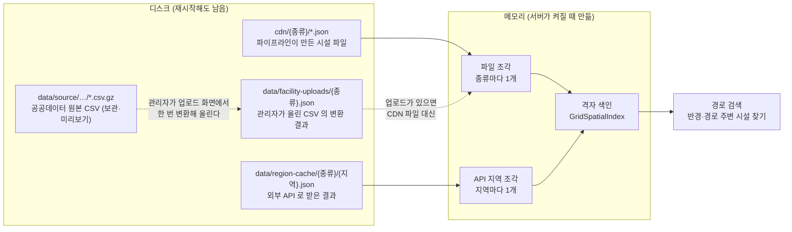
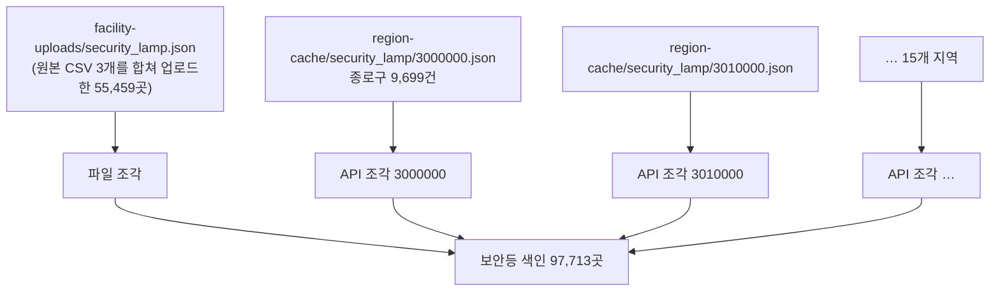
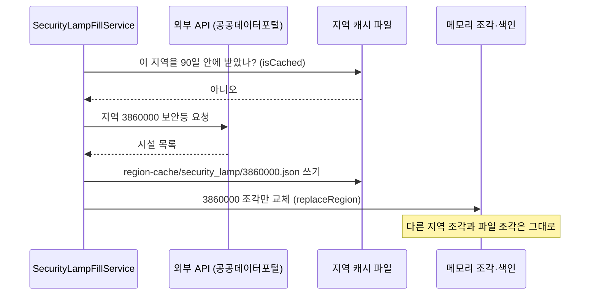
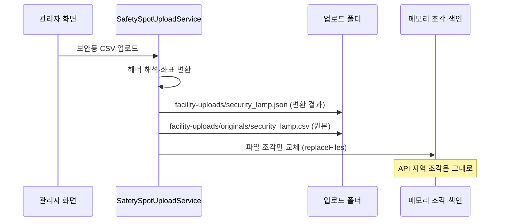
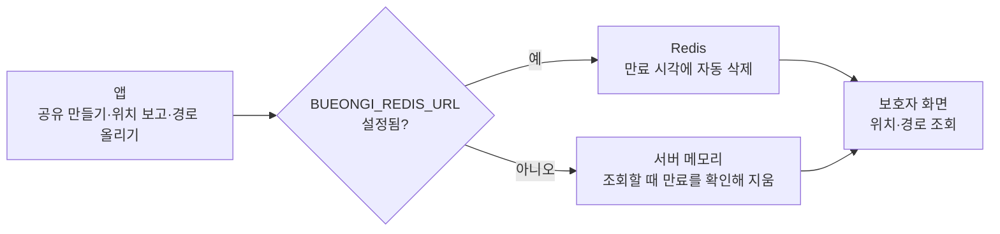

# 데이터 저장 구조

부엉이 백엔드가 데이터를 어디에, 어떤 모양으로 저장하고, 서버가 켜질 때와 실행 중에 그 데이터가 어떻게 움직이는지 정리한다.

관련 문서: [API.md](API.md) · [EXTERNAL_SERVICES.md](EXTERNAL_SERVICES.md) · [LOCATION_SHARING_DESIGN.md](LOCATION_SHARING_DESIGN.md)

## 결론

데이터베이스(DB)는 쓰지 않는다.

안심시설(CCTV·보안등·비상벨 등)은 **원본을 디스크에 파일로 두고**, 서버가 켜질 때 그 파일을 읽어 **메모리에 검색용 색인**을 만든다.

경로 검색 같은 조회는 메모리 색인만 본다. 파일은 다시 읽지 않는다.

위치 공유 세션은 **Redis**(만료 시각이 되면 스스로 지워지는 키-값 저장소)에 둔다. Redis 를 설정하지 않으면 메모리에 둔다.

외부 API 로 받은 시설 데이터는 관리자 CSV 업로드나 재시작으로 지워지지 않는다.

## 안심시설별 문서

종류마다 들어오는 길과 갱신 방식이 달라 문서를 나눴다. 각 문서 끝에 "이 방식이 맞는가"를 적었다.

| 종류 | 실데이터가 오는 곳 | 색인 | 판정 |
|---|---|---|---|
| [CCTV](safety-spots/cctv.md) | 관리자 업로드(원본 CSV) | 212,932 | 맞음 |
| [가로등](safety-spots/street-lamp.md) | CDN 파일 2개 + API 전국 | 33,245 | 맞음 |
| [보안등](safety-spots/security-lamp.md) | 업로드(통합 CSV) + API 지자체별 | 97,713 | 맞음. 전국 CSV 잘림 의심, 출처 간 중복 확인 필요 |
| [비상벨](safety-spots/emergency-bell.md) | CDN 전국 파일 | 75,391 | 맞음. 기준일 기록 없음 |
| [아동안전지킴이집](safety-spots/safehouse.md) | API 지도 칸별 | 1,236 | 맞음. 첫 요청에 데이터 없음 영향이 가장 큼 |
| [치안시설](safety-spots/police.md) | API 전국 | 2,875 | 맞음 |
| [보행신호등](safety-spots/pedestrian-signal.md) | 없음 (업로드 전용) | 0 | 저장 방식은 문제없음. 데이터가 없음 |
| [범죄주의구간](safety-spots/crime-prone-area.md) | 없음 (업로드 전용) | 0 | 저장 방식은 문제없음. 데이터가 없어 감점이 작동하지 않음 |

### 이 저장 방식은 적절한가

**구조는 적절하다.** 공공 시설 데이터는 읽기만 하고, 새 판이 통째로 나오거나 지역 단위로 조회된다. 그래서 "원본은 파일, 조회는 메모리 색인, 바꿀 때는 출처·지역 조각 단위" 구조가 데이터 성격과 맞는다.

**문제는 구조보다 데이터 쪽에 있다.**

1. **처음 가는 지역의 첫 요청에는 API 데이터가 없을 수 있다.** 수집이 응답을 기다리지 않고 뒤에서 돌기 때문이다. 서버 안에 대신할 전국 파일이 없는 지킴이집이 가장 영향을 받는다.

2. **CDN 파일(가로등·비상벨)을 새로 고치는 절차는 코드 밖에 있다.** 사람이 갈아 끼우고 재시작해야 한다. CSV 는 2026-10-11 관리자 업로드로 일원화해 교체 시각이 화면에 남는다.

3. **데이터가 없는 종류가 둘 있다.** 보행신호등과 범죄주의구간이다. 안심귀갓길도 0건이라 안전 점수에서 그 축이 빠진다.

파이프라인이 샘플 원천으로 만든 CDN 파일(CCTV·보안등·비상벨·지킴이집·치안시설·보행신호등·안심귀갓길, 모두 17곳)과 그 실행의 `manifest.json` 은 2026-10-11 에 지웠다. 실제 시설처럼 마커로 나가고 있었다.

### 코드에서 종류별로 찾는 곳

| 종류 | 위치 (`storage/db-safety-spot/.../safetyspot/`) |
|---|---|
| CCTV | `cctv/CctvSpot.kt`(시설 모양) |
| 가로등 | `streetlamp/StreetLampSpot.kt` |
| 보안등 | `securitylamp/SecurityLampSpot.kt` |
| 비상벨 | `bell/BellSpot.kt` |
| 아동안전지킴이집 | `safehouse/SafeHouseSpot.kt` |
| 치안시설 | `police/PoliceSpot.kt` |
| 보행신호등 | `pedestriansignal/PedestrianSignalSpot.kt` |
| 범죄주의구간 | `crimepronearea/CrimeProneAreaSpot.kt` |

모든 종류가 같이 쓰는 것은 종류 폴더 밖에 둔다. 부모 타입 `SafetySpotPoint`·좌표·파일 형식은 `model/`, 색인·지역 캐시·업로드·조각 묶기는 `store/` 다.

CSV 를 해석하는 코드는 storage 가 아니라 core 의 시설별 계약이다 — `core-admin-safety-spot/domain/csv/<시설명>/XxxCsvContract.kt`. 업로드·원본 미리보기·적재가 전부 이 계약 하나로 판정한다(적재는 업로드가 변환해 둔 JSON 을 읽는 것으로 일원화, 2026-10-11).

외부 API 로 받는 코드는 storage 가 아니라 `core/core-safety-spot/.../domain/{streetlamp,securitylamp,safehouse,police}/` 에 있다.

## 1. 전체 그림



시설 종류마다 위 구조가 하나씩 있다. 보안등이면 "보안등 파일 조각 1개 + 보안등 API 지역 조각 여러 개 → 보안등 색인 1개"다.

## 2. 디스크 — 시설 원본이 있는 네 곳

| 위치 | 누가 쓰나 | 실제 예 (2026-10-10 로컬 기준) |
|---|---|---|
| `cdn/{종류}/*.json` | 백엔드 밖 파이프라인(`pipeline/`) | 가로등 `cdn/lamp/seoul.json`·`smart.json`, 비상벨 `cdn/emergency_bell/nationwide.json` 3개뿐 |
| `backend/data/source/…/*.csv.gz` | 사람이 공공데이터포털에서 받아 보관 — 적재는 업로드를 거친다 | `전국보안등정보표준데이터.csv.gz`, `CCTV정보.csv.gz` 등 |
| `backend/data/region-cache/{종류}/{지역}.json` | 서버 (외부 API 결과) | 보안등 15개 지역, 가로등·치안시설 `nationwide.json`, 지킴이집 지도 격자 10개 |
| `backend/data/facility-uploads/{종류}.json` | 서버 (관리자 CSV 업로드) | `cctv.json`(319,164), `security_lamp.json`(55,459) — 원본 CSV 를 업로드로 옮김(2026-10-11) |

경로는 설정으로 바꿀 수 있다. 기본값은 각 저장소 클래스의 `@Value` 에 있다.

```kotlin
// SafetySpotRepository.kt:25 — CDN 파일 폴더
@param:Value("\${bueongi.facility.data-dir:../cdn}") private val configuredDir: String,

// SafetySpotRegionCache.kt:23 — 외부 API 결과를 저장하는 폴더
@param:Value("\${bueongi.facility.region-cache-dir:./data/region-cache}")

// SafetySpotUploadStore.kt:24 — 관리자 업로드 폴더
@param:Value("\${bueongi.facility.upload-dir:./data/facility-uploads}") private val uploadDir: String,
```

### 파일 하나의 모양

네 곳 중 JSON 파일(CDN·지역 캐시·업로드)은 모두 같은 모양이다. 한 파일에 `items` 목록이 있고, 항목 하나가 시설 한 곳이다.

외부 API 결과 파일(`region-cache/security_lamp/3000000.json`, 종로구, 9,699건)의 실제 항목 하나:

```json
{
  "savedAt": "2026-08-22T09:38:39.137297Z",
  "items": [
    {
      "name": "01-옥인6길15",
      "lat": 37.5814361,
      "lng": 126.9645941,
      "sigunguCode": "3000000",
      "address": "서울특별시 종로구 옥인6길15",
      "phone": "02-2148-3193"
    }
  ]
}
```

`savedAt` 은 받은 시각이다. 이 시각에서 90일이 지나면 그 지역을 다시 받는다.

이 모양을 코드에서는 `StoredSafetySpotCollection`·`StoredSafetySpotItem` 으로 읽고 쓴다. CDN 파일의 형식은 백엔드 밖 `pipeline/src/types.ts` 가 정한다.

## 3. 서버가 켜질 때 — 파일을 읽어 조각으로 묶는다

순서는 다음과 같다.

1. CDN 파일을 읽어 종류별 **파일 조각**을 만든다.

2. 업로드 파일이 있는 종류는 파일 조각을 업로드 내용으로 **대신한다**.

3. 지역 캐시 파일을 지역마다 읽어 **API 지역 조각**으로 붙인다. 업로드가 있어도 이 조각은 그대로 붙는다.

4. 종류마다 모든 조각을 합쳐 격자 색인을 만든다.

```kotlin
// SafetySpotRepository.kt:75-87 (발췌, … 는 생략한 줄)
fileCount += readSafetySpotFiles(dir, filesByType)            // 1. CDN 파일
…
val uploadedTypes: Int = overwriteWithUploads(filesByType)    // 2. 업로드가 있으면 파일 조각을 대신

val sources: LinkedHashMap<SafetySpotType, SafetySpotSources> = LinkedHashMap()

for ((type, points) in filesByType) {
    sources[type] = SafetySpotSources.EMPTY.withFiles(points)
}
val cachedRegions: Int = addRegionCache(sources)              // 3. API 지역 조각
sourcesByType.set(sources)                                    // 4. 색인은 조각을 만들 때 함께 생긴다
```

보안등을 예로 들면 이렇게 묶인다.



조각을 묶는 타입은 `SafetySpotSources` 다. 색인을 만들 때 API 조각을 파일 조각보다 앞에 둔다.

```kotlin
// SafetySpotSources.kt (발췌)
class SafetySpotSources(
    private val files: List<SafetySpotPoint>,                 // 파일 조각
    private val regions: Map<String, List<SafetySpotPoint>>,  // 지역 코드 → API 조각
) {
    val index: GridSpatialIndex = GridSpatialIndex(regionsBeforeFiles())
    …
}
```

색인은 좌표(소수점 5자리, 약 1.1m)가 같은 점을 한 곳으로 센다. 이때 먼저 들어온 점이 남는다. API 조각이 앞에 있으므로, 파일과 API 에 같은 시설이 있으면 **더 최신인 API 쪽이 남는다**.

```kotlin
// GridSpatialIndex.kt:14 — 좌표가 같은 점은 먼저 들어온 하나만 남긴다
points.distinctBy { Pair(roundCoord(it.lat), roundCoord(it.lng)) }
```

**확정** — 로컬 서버의 기동 로그로 확인 (2026-10-11, 샘플 삭제 뒤):
`files=3, uploadedTypes=2, regions=27, cctv=212932, lamp=33245, securityLamp=97713, bell=75391, safehouse=1236, police=2875, pedestrianSignal=0, safepaths=0`

## 4. 실행 중에 바뀌는 두 경우

실행 중에 데이터가 바뀌는 길은 둘뿐이다. 둘 다 **디스크에 먼저 쓰고, 메모리에서 해당 조각만 바꾼다.**

### 4-1. 외부 API 로 한 지역을 받을 때

경로가 아직 받지 않은 지역에 닿으면, 그 지역의 시설을 외부 API 로 받는다.



```kotlin
// SecurityLampFillService.kt:78-83
cache.save(SafetySpotType.SECURITY_LAMP, regionCode, points)               // 디스크에 먼저
if (points.isEmpty()) {                                                     // 빈 결과는 메모리에 반영하지 않는다
    events.hadNoCoordinates(SafetySpotType.SECURITY_LAMP, regionCode, fetched.size)
    return 0
}
liveStore.replaceRegion(SafetySpotType.SECURITY_LAMP, regionCode, points)  // 그 지역 조각만 교체
```

90일 뒤 다시 받으면 그 지역 조각이 새 결과로 바뀐다. 주소·전화가 바뀐 시설은 새 값이 되고, 없어진 시설은 빠진다.

다시 받은 결과가 **비어 있으면 기존 데이터를 지우지 않는다.** 메모리는 위 코드처럼 반영하지 않고, 파일은 기존 항목을 그대로 두고 받은 시각만 새로 한다.

```kotlin
// SafetySpotRegionCache.kt:67-71
// 다시 받은 결과가 비어도 전에 받은 API 데이터는 지우지 않는다 — 저장 시각만 새로 해 곧바로 다시 받지 않게 한다.
var kept: List<SafetySpotPoint> = points
if (points.isEmpty()) {
    kept = load(type, regionCode)
}
```

### 4-2. 관리자가 CSV 를 올릴 때



```kotlin
// SafetySpotUploadService.kt:30-32
uploadStore.save(type, parsed.points)        // 변환 결과
uploadStore.saveOriginal(type, plain)        // 원본 (관리자 CSV 보기 화면용, gz 는 풀어서 보관)
liveStore.replaceFiles(type, parsed.points)  // 파일 조각만 교체
```

업로드는 그 종류의 **파일 출처(CDN 파일·이전 업로드)를 대신한다.** 외부 API 로 받은 지역 조각은 남는다. `.gz` 로 올려도 되고(한도 128MB), CCTV 원본은 압축 그대로 올린다.

### 원본 CSV 의 새 판이 나오면 — 반영 절차

서버는 `data/source/` 의 CSV 를 직접 적재하지 않으므로, 새 판은 관리자 화면에서 업로드한다.

1. **CCTV** — 공공데이터포털에서 받은 `CCTV정보.csv`(또는 `.gz` 그대로)를 CCTV 종류로 업로드한다.

2. **보안등** — 파일이 여러 개면 하나로 합쳐 올린다. 업로드는 종류마다 파일 하나이기 때문이다.
   머리글이 가장 긴 파일(전국 표준데이터 13칸)을 기준으로 삼고, 칸이 적은 지자체 파일 행은 뒤를 빈칸으로 채운다.

   ```python
   import csv, gzip, io
   def rows(path):                                   # cp949·utf-8 모두 온다
       raw = gzip.open(path).read() if path.endswith(".gz") else open(path, "rb").read()
       for encoding in ("utf-8-sig", "cp949"):
           try: return list(csv.reader(io.StringIO(raw.decode(encoding))))
           except UnicodeDecodeError: pass
   nation = rows("전국보안등정보표준데이터.csv.gz")       # 머리글 13칸
   merged = nation[:]
   for path in ["경상남도_고성군_보안등정보.csv.gz", "경상북도_칠곡군_보안등정보.csv.gz"]:
       extra = rows(path)                             # 머리글 11칸 — 앞 11칸이 전국과 같은지 확인하고
       assert extra[0] == nation[0][: len(extra[0])]
       merged += [row + [""] * (len(nation[0]) - len(extra[0])) for row in extra[1:]]
   with open("보안등_통합.csv", "w", newline="", encoding="utf-8") as f:
       csv.writer(f).writerows(merged)
   ```

3. 받은 원본은 `data/source/` 에도 보관해 둔다(관리자 CSV 화면의 원본 미리보기·출처 추적용).

업로드하면 바로 반영되고 재시작 없이 유지된다. 교체 시각·건수는 관리자 시설 현황 화면에 남는다.

**확정** — 업로드 폴더와 지역 캐시 폴더를 임시 복사본으로 바꾼 별도 포트 서버에 보안등 CSV 2건을 올려 확인 (2026-10-10):
보안등 색인이 97,715곳에서 49,490곳이 되었다. 지역 캐시에 있던 API 보안등 49,488곳 + 업로드 2곳이다.

## 5. 조회 — 메모리 색인만 본다

색인은 지도를 가로세로 0.001°(약 100m) 격자 칸으로 나누고, 칸마다 그 안의 시설 목록을 들고 있다.

"이 경로 양옆 몇 m 안의 시설"을 물으면, 경로가 지나는 칸과 그 주변 칸만 훑은 뒤 거리를 다시 재서 걸러 낸다. 파일은 읽지 않는다.

```kotlin
// GridSpatialIndex.kt:39, :106 (발췌)
fun withinCorridor(path: List<GeoPoint>, corridorM: Double): List<SafetySpotPoint> { … }
private const val CELL_DEG: Double = 0.001
```

조각 하나가 바뀌면 그 종류의 색인 전체를 다시 만든다. 실측 시간은 3.3만 곳 12ms, 9.8만 곳 51ms, 21만 곳 216ms다(5회 중앙값, 2026-10-10).

지역 하나를 받는 일은 지역마다 90일에 한 번이라 지금은 문제가 되지 않는다. 잦아지면 칸 단위로 빼고 넣는 방식으로 바꾼다(`SafetySpotSources.kt` 의 `ponytail:` 주석).

## 6. 위치 공유 세션 — Redis

공유 세션 하나는 Redis 키 넷으로 저장된다. `{토큰}` 은 공유 URL 에 들어가는 무작위 문자열이다.

| 키 | 담는 것 |
|---|---|
| `share:{토큰}` | 생성 시각, 만료 시각, 소유자 비밀값, 도착 예정 시각 |
| `location:{토큰}` | 마지막 위치, 남은 거리·시간 |
| `route:{토큰}` | 경로 JSON (`StoredRoute`) |
| `viewer:{토큰}` | 보호자가 보고 있는지 |

```kotlin
// RedisLocationStore.kt:192-207 — 키 이름
const val SESSION_KEY_PREFIX: String = "share:"

fun shareKey(token: String): String {
    return "$SESSION_KEY_PREFIX$token"
}

fun locationKey(token: String): String {
    return "location:$token"
}

fun routeKey(token: String): String {
    return "route:$token"
}

fun viewerKey(token: String): String {
    return "viewer:$token"
}

// RedisLocationStore.kt:42 — 만료 시각에 Redis 가 키를 지운다
redis.expire(shareKey, ttl)
```

세션은 최대 3시간 뒤 사라진다. 이름·전화번호 같은 개인정보는 저장하지 않는다.



## 7. 재시작하면 남는 것과 사라지는 것

| 데이터 | 저장 위치 | 재시작 후 |
|---|---|---|
| 안심시설 (CDN·CSV·업로드·API) | 디스크 파일 | 남음. 같은 색인이 다시 만들어진다 |
| 위치 공유 세션 | Redis | 남음 (만료 전까지) |
| 위치 공유 세션 (Redis 미설정) | 메모리 | 사라짐 |
| 장애 알림 이력 (최대 500건) | 메모리 (`SlackAlertNotifier.recentAlerts`) | 사라짐 |
| 시설 교체 기록 (마지막 업로드 시각·건수) | 메모리 (`SafetySpotRefreshStatusStore.records`) | 사라짐 |

메모리에만 있는 둘은 "최근 상태를 보여 주는" 용도라 재시작 때 비어도 괜찮다고 판단했다.

알림·업로드 이력을 오래 남겨야 하거나, 사용자 계정처럼 사람마다 남는 데이터가 생기면 그때 DB 를 들인다.
