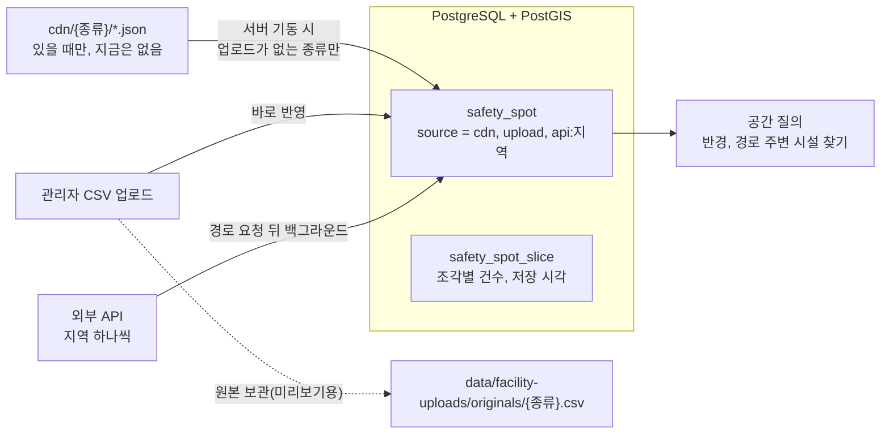
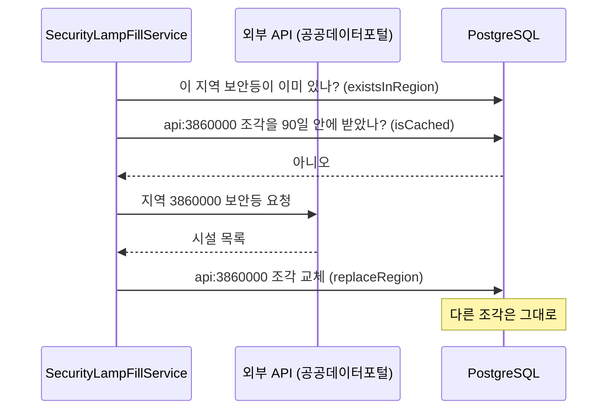
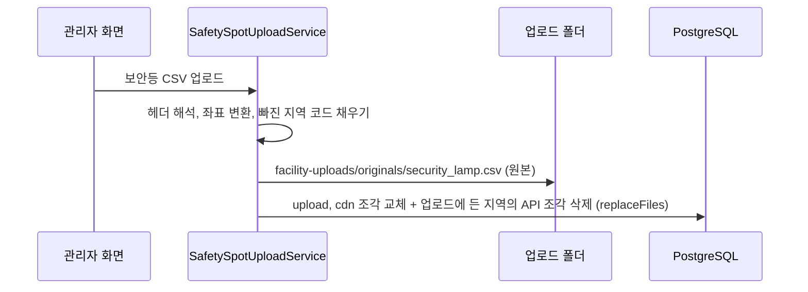
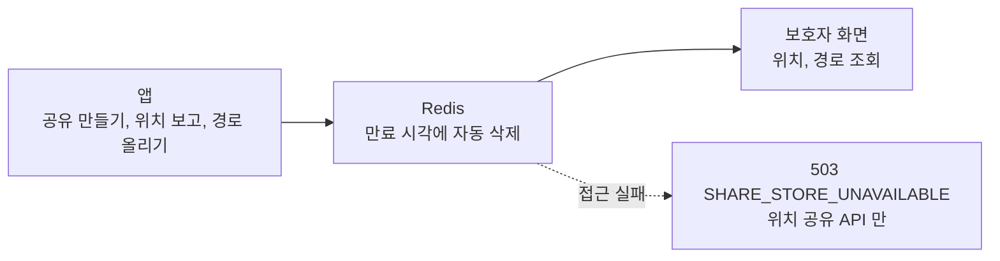

# 데이터 저장 구조

부엉이 백엔드가 데이터를 어디에, 어떤 모양으로 저장하고, 서버가 켜질 때와 실행 중에 그 데이터가 어떻게 움직이는지
정리한다.

관련 문서: [API.md](API.md), [EXTERNAL_SERVICES.md](EXTERNAL_SERVICES.md),
[LOCATION_SHARING_DESIGN.md](LOCATION_SHARING_DESIGN.md)

## 결론

안심시설(CCTV, 보안등, 비상벨 등)은 **PostgreSQL + PostGIS**(공간 질의를 하는 확장)에 둔다. 테이블은 둘이다. 시설
한 곳이 `safety_spot` 한 행이고, 출처 조각마다 저장 시각이 `safety_spot_slice`에 남는다.

경로 검색 같은 조회는 DB에 공간 질의를 보낸다. 서버 메모리에는 시설을 두지 않는다. 그래서 업로드 결과가 재배포 때
사라지지 않고, 서버를 여러 대로 늘려도 모두 같은 데이터를 본다.

위치 공유 세션은 **Redis**(만료 시각이 되면 스스로 지워지는 키-값 저장소)에만 둔다. 메모리 대체 저장소는 없다. Redis 가
내려가 있으면 위치 공유 API 만 503 을 돌려주고 다른 API 는 영향이 없다.

외부 API 로 받은 시설 데이터는 재시작으로 지워지지 않는다. 관리자 CSV 업로드는 업로드에 든 지역의 API 조각만 지운다.

## 안심시설별 문서

종류마다 들어오는 길과 갱신 방식이 달라 문서를 나눴다. 각 문서 끝에 "이 방식이 맞는가"를 적었다. "곳 수"는
2026-10-11 메모리 색인 시절에 같은 좌표를 한 곳으로 센 값이다.

| 종류                                             | 실데이터가 오는 곳              |   곳 수 | 판정                                                     |
|--------------------------------------------------|---------------------------------|--------:|----------------------------------------------------------|
| [CCTV](safety-spots/cctv.md)                     | 관리자 업로드(원본 CSV)         | 212,932 | 맞음                                                     |
| [가로등](safety-spots/street-lamp.md)            | 업로드(통합 CSV) + API 전국     |  33,245 | 맞음                                                     |
| [보안등](safety-spots/security-lamp.md)          | 업로드(통합 CSV) + API 지자체별 |  97,713 | 맞음. 전국 CSV 잘림 의심, 출처 간 중복 확인 필요         |
| [비상벨](safety-spots/emergency-bell.md)         | 관리자 업로드(원본 CSV)         |  75,056 | 맞음. 2026-11-25 업로드 규격 수정 뒤                     |
| [아동안전지킴이집](safety-spots/safehouse.md)    | API 지도 칸별                   |   1,236 | 맞음. 첫 요청에 데이터 없음 영향이 가장 큼               |
| [치안시설](safety-spots/police.md)               | API 전국                        |   2,875 | 맞음                                                     |
| [보행신호등](safety-spots/pedestrian-signal.md)  | 없음(업로드 전용)               |       0 | 저장 방식은 문제없음. 데이터가 없음                      |
| [범죄주의구간](safety-spots/crime-prone-area.md) | 없음(업로드 전용)               |       0 | 저장 방식은 문제없음. 데이터가 없어 감점이 작동하지 않음 |

### 이 저장 방식은 적절한가

**구조는 적절하다.** 공공 시설 데이터는 읽기만 하고, 새 판이 통째로 나오거나 지역 단위로 조회된다. 그래서 "출처/지역
조각 단위로 통째로 바꾸고, 조회는 공간 인덱스로" 구조가 데이터 성격과 맞는다.

**문제는 구조보다 데이터 쪽에 있다.**

1. **처음 가는 지역의 첫 요청에는 API 데이터가 없을 수 있다.** 수집이 응답을 기다리지 않고 뒤에서 돌기 때문이다. 서버
   안에 대신할 전국 파일이 없는 지킴이집이 가장 영향을 받는다.
2. **가로등은 새 DB 에 자동으로 들어오지 않는다.** 2026-11-27 CDN 파일을 지워, 원본 CSV 두 개를 합쳐 업로드해야
   들어온다. CSV 는 2026-10-11 관리자 업로드로 일원화해 교체 시각이 화면에 남는다.
3. **데이터가 없는 종류가 둘 있다.** 보행신호등과 범죄주의구간이다. 안심귀갓길도 0건이라 안전 점수에서 그 축이 빠진다.

샘플 원천으로 만든 CDN 파일(CCTV, 보안등, 비상벨, 지킴이집, 치안시설, 보행신호등, 안심귀갓길, 모두 17곳)과
그 실행의 `manifest.json`은 2026-10-11 에 지웠다. 실제 시설처럼 마커로 나가고 있었다.

### 코드에서 종류별로 찾는 곳

| 종류             | 위치(`storage/db-safety-spot/.../safetyspot/`) |
|------------------|------------------------------------------------|
| CCTV             | `cctv/CctvSpot.kt`(시설 모양)                  |
| 가로등           | `streetlamp/StreetLampSpot.kt`                 |
| 보안등           | `securitylamp/SecurityLampSpot.kt`             |
| 비상벨           | `bell/BellSpot.kt`                             |
| 아동안전지킴이집 | `safehouse/SafeHouseSpot.kt`                   |
| 치안시설         | `police/PoliceSpot.kt`                         |
| 보행신호등       | `pedestriansignal/PedestrianSignalSpot.kt`     |
| 범죄주의구간     | `crimepronearea/CrimeProneAreaSpot.kt`         |

모든 종류가 같이 쓰는 것은 종류 폴더 밖에 둔다. 부모 타입 `SafetySpotPoint`와 좌표는 `model/`이고, DB 저장과 조회
(`PostgisSafetySpotStore`), 기동 때 CDN 반영(`SafetySpotCdnFiles`, `SafetySpotCdnSync`), 재수집 주기 판정
(`SafetySpotRegionCache`), 지역 코드 찾기(`RegionLocator`)는 `store/`다. 테이블은
`src/main/resources/db/migration/V202611251400__create_safety_spot.sql`(Flyway)이 만든다.

core 는 DB 를 직접 모른다. 조회는 `SafetySpotSpatialSource`, 쓰기는 `SafetySpotLiveStore` 인터페이스만 본다. 테스트는
메모리 대역(`FakeSafetySpotSource`)을 쓴다.

CSV 를 해석하는 코드는 storage 가 아니라 core 의 시설별 형식이다:
`core-admin-safety-spot/.../domain/csv/<시설명>/XxxCsvFormat.kt`. 업로드와 원본 미리보기가 이 형식 하나로 판정한다.

외부 API 로 받는 코드는 storage 가 아니라 `core/core-safety-spot/.../domain/{streetlamp,securitylamp,safehouse,police}/`에
있다. 무엇이 언제 부르는지는 [EXTERNAL_SERVICES.md](EXTERNAL_SERVICES.md)에 있다.

## 1. 전체 그림



출처 조각 하나는 `(type, source)` 쌍이다. 보안등이면 "업로드 조각 1개 + 자치단체마다 API 조각 1개"가 같은 테이블에 있다.

| `source`        | 넣는 곳                   | 바뀌는 때                                  |
|-----------------|---------------------------|--------------------------------------------|
| `cdn`           | `SafetySpotCdnSync`(기동) | CDN 디렉터리가 있고 업로드가 없을 때만     |
| `upload`        | 관리자 CSV 업로드         | 업로드할 때. 그 종류의 `cdn` 조각도 지운다 |
| `api:<지역 키>` | 외부 API 채우기 서비스    | 그 지역을 받을 때(90일마다)                |

지역 키는 종류마다 다르다. 보안등은 개방자치단체코드, 가로등과 치안시설은 전국 한 덩이 `nationwide`, 지킴이집은 지도 칸
코드다.

## 2. 테이블

`safety_spot`은 시설 한 곳이 한 행이다.

| 컬럼                                                  | 내용                                                           |
|-------------------------------------------------------|----------------------------------------------------------------|
| `type`, `source`                                      | 시설 종류(`cctv`, `security_lamp` 등)와 출처 조각              |
| `region_code`                                         | 지역 코드. 없을 수 있다                                        |
| `name`, `address`, `phone`, `purpose`, `camera_count` | 마커와 화면에 보이는 값                                        |
| `lat`, `lng`                                          | 위경도                                                         |
| `geog`                                                | `GEOGRAPHY(Point, 4326)` 생성 컬럼. GIST 인덱스로 공간 질의    |
| `lat_e5`, `lng_e5`                                    | 좌표 소수 5자리(약 1.1m) 생성 컬럼. 같은 지점을 한 곳으로 센다 |
| `from_api`                                            | `source`가 `api:`로 시작하는지. 생성 컬럼                      |

인덱스는 `geog`의 GIST 하나와 `(type, source)`, `(type, region_code)` B-tree 둘이다.

`safety_spot_slice`는 조각마다 한 행이다. 키는 `(type, source)`이고 `row_count`, `saved_at`을 담는다. `saved_at`이
`bueongi.facility.region-cache-ttl-days`(기본 90일)보다 오래되면 그 API 지역을 다시 받는다. 0건으로 받은 지역도
기록해 그동안 다시 묻지 않는다.

접속 설정은 `db-safety-spot.yml`이 `BUEONGI_DB_URL`, `BUEONGI_DB_USERNAME`, `BUEONGI_DB_PASSWORD`로 받는다.
비밀번호는 기본값이 없고, `local` 프로파일만 개발용 값 `bueongi`를 준다. 마이그레이션 버전이 시각이라
`spring.flyway.out-of-order: true`로 둔다.

## 3. 서버가 켜질 때

1. Flyway 가 마이그레이션을 적용한다. 처음이면 `postgis` 확장과 두 표를 만든다.
2. `SafetySpotCdnFiles`가 `cdn/`(`BUEONGI_FACILITY_DATA_DIR`)을 읽는다. 지금은 이 디렉터리가 없어 3, 4는 건너뛴다.
3. `SafetySpotCdnSync`가 종류마다 CDN 시설을 `cdn` 조각으로 바꿔 넣는다. 그 종류에 `upload` 조각이 있으면 건너뛴다.
4. 안심귀갓길(`safepath/`)과 신선도(`manifest.json`)는 작아서 DB 에 넣지 않고 메모리에 둔다.

업로드분과 API 조각은 DB 에 이미 있으므로 기동 때 다시 읽을 것이 없다.

**확정**: 새 DB 에 bootJar 를 띄워 Flyway 적용과 CDN 가로등 32,005건 반영을 확인했다(2026-11-25, CDN 파일을 지우기
전). 기동 로그 ERROR 0.

## 4. 실행 중에 바뀌는 두 경우

실행 중에 데이터가 바뀌는 길은 둘뿐이다. 둘 다 **조각 하나를 지우고 새로 넣기를 한 트랜잭션으로** 한다
(`JdbcTemplate.batchUpdate`, 1,000행씩, `reWriteBatchedInserts`). 읽는 쪽은 바뀌기 전이나 바뀐 뒤 둘 중 하나만 본다.

### 4-1. 외부 API 로 한 지역을 받을 때

경로가 아직 받지 않은 지역에 닿으면, 그 지역의 시설을 외부 API 로 받는다.



90일 뒤 다시 받으면 그 지역 조각이 새 결과로 바뀐다. 주소나 전화가 바뀐 시설은 새 값이 되고, 없어진 시설은 빠진다.

받은 결과가 비어 있으면 이전 API 조각은 지우지 않고 저장 시각만 새로 한다. 외부 API 가 잠시 빈 결과를 줘도 데이터가
사라지지 않게 하고, 좌표를 주지 않는 지자체(마포, 강남 등)를 재수집 주기 동안 다시 묻지 않기 위해서다.

### 4-2. 관리자가 CSV 를 올릴 때



업로드는 그 종류의 **`upload`와 `cdn` 조각을 대신한다.** 업로드에 든 지역 코드와 같은 API 조각은 지운다. 같은 시설을
좌표만 조금 달리 두 번 세지 않기 위해서다. 다른 지역의 API 조각은 남는다.

지역 코드가 빈 행은 `RegionLocator`로 채운다. 20km 안에서 지역 코드가 있는 가장 가까운 CCTV 를 KNN(`<->`)으로 찾고,
약 1km 칸(0.01도)마다 한 번만 묻는다. CCTV 가 먼저 올라가 있어야 찾을 수 있다.

`.gz`로 올려도 되고(한도 128MB, `BUEONGI_FACILITY_UPLOAD_MAX_SIZE`), CCTV 원본은 압축 그대로 올린다. 원본 CSV 는
관리자 CSV 보기 화면용으로 `{BUEONGI_FACILITY_UPLOAD_DIR}/originals/{종류}.csv`에 종류마다 최신 하나만 둔다.

**확정**: 실제 원본을 올려 확인했다(2026-11-25). 같은 파일을 다시 올려도 중복이 생기지 않았다.

| 종류   |   행 수 | 시간(초) |
|--------|--------:|---------:|
| CCTV   | 319,164 |     12.4 |
| 비상벨 |  88,621 |      3.6 |
| 보안등 |  55,458 |      2.6 |

보안등 55,458행은 모두 지역 코드가 채워졌다.

### 원본 CSV 의 새 판이 나오면: 반영 절차

서버는 `data/source/`의 CSV 를 직접 적재하지 않으므로, 새 판은 관리자 화면에서 업로드한다.

1. **CCTV**: 공공데이터포털에서 받은 `CCTV정보.csv`(또는 `.gz` 그대로)를 CCTV 종류로 업로드한다.
2. **보안등**: 파일이 여러 개면 하나로 합쳐 올린다. 업로드는 종류마다 파일 하나이기 때문이다. 머리글이 가장 긴
   파일(전국 표준데이터 13칸)을 기준으로 삼고, 칸이 적은 지자체 파일 행은 뒤를 빈칸으로 채운다.

   ```python
   import csv, gzip, io
   def rows(path):                                   # cp949, utf-8 모두 온다
       raw = gzip.open(path).read() if path.endswith(".gz") else open(path, "rb").read()
       for encoding in ("utf-8-sig", "cp949"):
           try: return list(csv.reader(io.StringIO(raw.decode(encoding))))
           except UnicodeDecodeError: pass
   nation = rows("전국보안등정보표준데이터.csv.gz")       # 머리글 13칸
   merged = nation[:]
   for path in ["경상남도_고성군_보안등정보.csv.gz", "경상북도_칠곡군_보안등정보.csv.gz"]:
       extra = rows(path)                             # 머리글 11칸 - 앞 11칸이 전국과 같은지 확인하고
       assert extra[0] == nation[0][: len(extra[0])]
       merged += [row + [""] * (len(nation[0]) - len(extra[0])) for row in extra[1:]]
   with open("보안등_통합.csv", "w", newline="", encoding="utf-8") as f:
       csv.writer(f).writerows(merged)
   ```

3. **가로등**: 머리글이 다른 두 파일을 머리글 이름 기준으로 합쳐 올린다. 절차는
   [가로등 문서](safety-spots/street-lamp.md)에 있다.
4. 받은 원본은 `data/source/`에도 보관해 둔다(관리자 CSV 화면의 원본 미리보기, 출처 추적용).

업로드하면 바로 반영되고 재시작 없이 유지된다. 교체 시각과 건수는 관리자 시설 현황 화면에 남는다.

## 5. 조회: DB 공간 질의

core 는 `SafetySpotSpatialSource`의 질의 메서드만 부른다. 구현은 `PostgisSafetySpotStore`다.

| 메서드                  | 하는 일                                                   |
|-------------------------|-----------------------------------------------------------|
| `findWithinCorridor`    | 경로 양옆 몇 m 안의 시설(`ST_DWithin`, geography 라 미터) |
| `findWithinRadius`      | 한 점에서 반경 안의 시설                                  |
| `existsWithinRadius`    | 반경 안에 하나라도 있는지                                 |
| `findByRegion`          | 지역 코드 하나의 시설                                     |
| `findNearestWithRegion` | 지역 코드가 있는 가장 가까운 시설(KNN `<->`)              |
| `countByOrigin`         | 파일 출처와 API 출처 건수(관리자 현황)                    |
| `tallyByRegion`         | 지역별 집계(관리자 지역 현황)                             |

같은 좌표(소수 5자리)는 `DISTINCT ON (lat_e5, lng_e5)`로 한 곳만 돌려준다. 겹치면 **더 최신인 API 출처가 남는다**
(`ORDER BY ... from_api DESC`).

**확정**: 실측(2026-11-25). 주변 안심시설 API 가 약 16ms(워밍 뒤), 서울 약 3km 경로의 회랑 질의가 종류당 4~20ms 였다.

## 6. 위치 공유 세션: Redis

공유 세션 하나는 Redis 키 넷으로 저장된다. `{토큰}`은 공유 URL 에 들어가는 무작위 문자열이다.

| 키                | 담는 것                                             |
|-------------------|-----------------------------------------------------|
| `share:{토큰}`    | 생성 시각, 만료 시각, 소유자 비밀값, 도착 예정 시각 |
| `location:{토큰}` | 마지막 위치, 남은 거리와 시간                       |
| `route:{토큰}`    | 경로 JSON(`StoredRoute`)                            |
| `viewer:{토큰}`   | 보호자가 보고 있는지                                |

```kotlin
// RedisShareSessionStore.kt:196-212 - 키 이름
const val SESSION_KEY_PREFIX: String = "share:"

fun shareKey(token: String): String {
    return "$SESSION_KEY_PREFIX$token"
}

fun locationKey(token: String): String {
    return "location:$token"
}

fun routeKey(token: String): String {
    return "route:$token"
}

fun viewerKey(token: String): String {
    return "viewer:$token"
}

// RedisShareSessionStore.kt:43 - 만료 시각에 Redis 가 키를 지운다
redis.expire(shareKey, ttl)
```

세션은 최대 3시간 뒤 사라진다. 이름, 전화번호 같은 개인정보는 저장하지 않는다.

연결 주소는 `BUEONGI_REDIS_URL`(기본 `redis://localhost:6379`)이고, Spring Boot 자동구성의 `spring.data.redis.url`로
들어간다(`db-share.yml`). 연결은 첫 사용 때 맺는다. 운영 코드의 저장소는 `RedisShareSessionStore` 하나뿐이고,
`InMemoryShareSessionStore`는 테스트 픽스처(`storage/db-share/src/testFixtures`)에만 있다.



`/api/health`의 `locationStore`는 항상 `"redis"`다. 저장소 종류를 나타내는 값이지 연결 상태가 아니다.

## 7. 재시작하면 남는 것과 사라지는 것

| 데이터                                   | 저장 위치                                      | 재시작 후                                   |
|------------------------------------------|------------------------------------------------|---------------------------------------------|
| 안심시설(CDN, 업로드, API)               | PostgreSQL(운영 compose 의 `db-data` 볼륨)     | 남음                                        |
| 위치 공유 세션                           | Redis                                          | 남음(만료 전까지)                           |
| 업로드 원본 CSV(미리보기용)              | 디스크 `data/facility-uploads/originals/`      | 남음. 컨테이너를 새로 만들면 사라짐         |
| 안심귀갓길, 신선도                       | 메모리(`SafetySpotCdnFiles`)                   | 기동 때 CDN 파일에서 다시 읽음(지금은 없음) |
| 시설 교체 기록(마지막 업로드 시각, 건수) | 메모리(`SafetySpotRefreshStatusStore.records`) | 사라짐                                      |

메모리에만 있는 시설 교체 기록은 "최근 상태를 보여 주는" 용도라 재시작 때 비어도 괜찮다고 판단했다.
