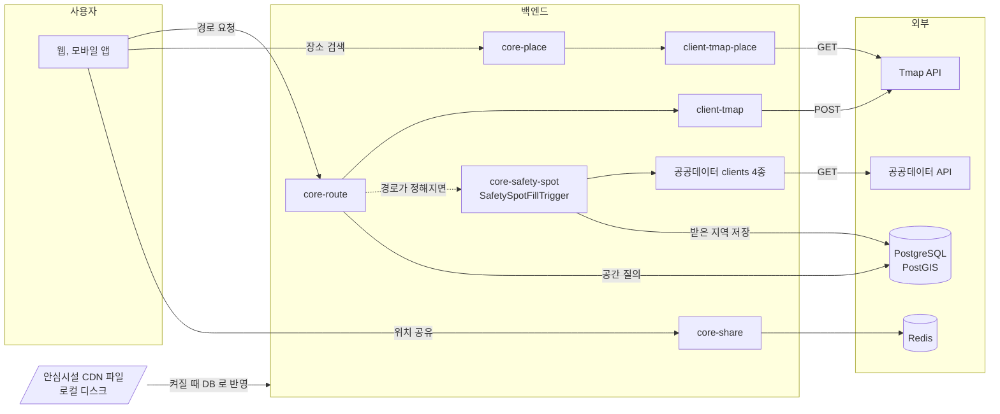
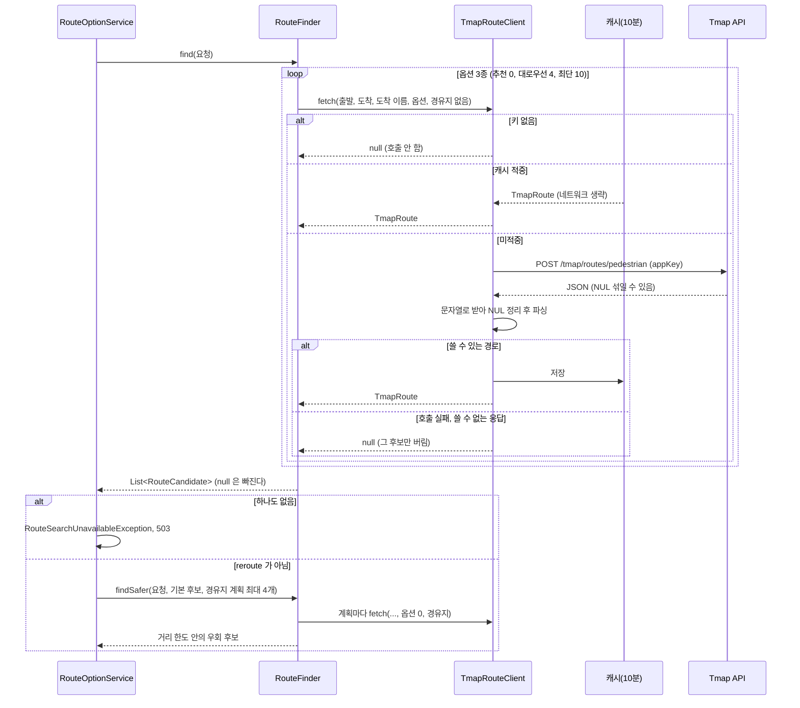

# 외부 서비스: 언제, 무엇이, 어떻게 불리나

처음 보는 사람을 위한 지도다. 이 서버가 바깥과 주고받는 모든 접점을 **켜질 때, 켜진 뒤 백그라운드, 요청이 올 때** 세
시점으로 나눠 적는다.

> 원천별 상세(인증, 쿼터, 필드)는 bueongi-service 저장소의 `docs/external-api-catalog.md`,
> 위치 공유 설계는 [`LOCATION_SHARING_DESIGN.md`](LOCATION_SHARING_DESIGN.md), 저장 구조는
> [`DATA_STORAGE.md`](DATA_STORAGE.md).

## 한눈 요약

**켜질 때 외부 API 호출은 없다.** 기동 중에 바깥과 닿는 것은 우리 인프라인 PostgreSQL 뿐이다(Flyway 마이그레이션,
CDN 파일 반영). Redis 는 첫 사용 때 연결한다.
외부 API(Tmap, 공공데이터 4종)는 전부 **사용자 요청이 있어야** 불린다.

```text
켜질 때        PostgreSQL 연결, Flyway, CDN 파일을 DB 로 반영  <- 외부 API 없음
켜진 뒤        주기적으로 도는 작업 없음
요청이 올 때   Tmap(경로, 장소 검색), 경로 요청 뒤 공공데이터 4종(뒤에서 채우기)
```

운영 알림은 앱이 보내지 않는다. 서버의 로그 감시가 ERROR 로그와 5xx 요청 로그를 보고 알린다.

### 외부 접점 목록

| 서비스           | 모듈                                    | 호스트                 | 키 환경변수              |
|------------------|-----------------------------------------|------------------------|--------------------------|
| Tmap 보행 경로   | `clients:client-tmap`                   | `apis.openapi.sk.com`  | `TMAP_APP_KEY`           |
| Tmap 장소 검색   | `clients:client-tmap-place`             | `apis.openapi.sk.com`  | `TMAP_APP_KEY`           |
| 보안등           | `clients:client-datagokr-security-lamp` | `api.data.go.kr`       | `DATA_GO_KR_SERVICE_KEY` |
| 가로등           | `clients:client-safetydata-street-lamp` | `www.safetydata.go.kr` | `SAFETYDATA_SERVICE_KEY` |
| 치안시설         | `clients:client-safemap`                | `safemap.go.kr`        | `SAFEMAP_SERVICE_KEY`    |
| 아동안전지킴이집 | `clients:client-safe182`                | `www.safe182.go.kr`    | `SAFE182_AUTH_KEY`       |
| PostgreSQL       | `storage:db-safety-spot`                | `BUEONGI_DB_URL` 값    | `BUEONGI_DB_PASSWORD`    |
| Redis            | `storage:db-share`                      | `BUEONGI_REDIS_URL` 값 | 없음                     |

### 전체 구조도



- **실선**은 요청이 있을 때만 흐르는 호출, **점선**은 뒤에서 이어지는 작업이다.
- 켜질 때 외부 API 로 나가는 것은 없다. 안심시설 CDN 파일은 로컬 디스크이고, 그것을 넣을 DB 만 연결한다.

## 1. 켜질 때: 기동 타임라인

```text
main() 시작
  │
  ├─ 1. 설정 검문      yml + 환경변수 바인딩. 값이 틀리면 여기서 죽는다(fail-fast).
  │                    예: 관리자 비밀번호가 bcrypt 형식이 아니면 APPLICATION FAILED TO START
  │
  ├─ 2. 빈 조립
  │     ├─ PostgreSQL     BUEONGI_DB_URL 로 연결하고 Flyway 가 마이그레이션을 적용한다.
  │     │                  DB 에 닿지 않으면 여기서 죽는다.
  │     ├─ 안심시설 반영   BUEONGI_FACILITY_DATA_DIR(기본 cdn)의 JSON 을 읽어 DB 의 cdn 조각으로 바꾼다.
  │     │                  업로드가 있는 종류는 건너뛴다. 업로드분과 API 조각은 이미 DB 에 있다.
  │     │                  CDN 디렉터리가 없으면 경고 로그 후 계속 뜬다.
  │     └─ Redis 설정      BUEONGI_REDIS_URL(기본 redis://localhost:6379). 연결은 첫 사용 때 한다.
  │
  └─ 3. 포트 오픈        기본 8080, local 프로파일 8119. "Started" 로그
```

**기동 때는 외부 API 를 부르지 않는다.** 부팅을 외부 API 지연에 묶지 않기 위해서다. 기본 시설 데이터는 파이프라인이 만든
CDN 파일과 관리자가 올린 CSV(둘 다 DB 에 저장)로 들어오고, 모자란 부분은 **경로 요청이 닿을 때 뒤에서 받는다**(2절).
저장 위치와 적재 순서는 [`DATA_STORAGE.md`](DATA_STORAGE.md)에 있다.

## 2. 켜진 뒤: 백그라운드

기동 뒤 주기적으로 도는 작업은 없다. 뒤에서 도는 것은 `SafetySpotFillTrigger` 하나이고, 경로 요청이 성공할 때마다
공공데이터 API 4종(아래)을 부른다. 전용 `safety-spot-fill` 스레드 하나에서만 돌고, **요청 스레드를 막지 않는다.**

### 안심시설 뒤에서 채우기: `SafetySpotFillTrigger`

`RouteOptionService`가 경로를 정하면 첫 기본 경로의 좌표열을 넘긴다. 트리거는 그 경로를 따라 2km 간격으로 최대 12개 점을
골라, 그 점이 닿은 곳의 데이터를 뒤에서 받아 채운다. 파일로 안 들어오는 종류만 해당한다. 이번 응답은 지금 있는 것으로
나가고, 다음 요청부터 채워진 데이터가 보인다.

| 종류             | 클라이언트                      | 받는 단위                   | 다시 받기 |
|------------------|---------------------------------|-----------------------------|-----------|
| 보안등           | `client-datagokr-security-lamp` | 자치단체 하나(`instt_code`) | 90일 뒤   |
| 가로등           | `client-safetydata-street-lamp` | 전국 한 덩이                | 90일 뒤   |
| 치안시설         | `client-safemap`                | 전국 한 덩이                | 90일 뒤   |
| 아동안전지킴이집 | `client-safe182`                | 지도 격자 한 칸(0.1도)      | 90일 뒤   |

- 가로등 API 는 지역 조건을 받지 않는다. 전량이 2페이지라 싸다.
- 치안시설은 전량 4페이지이고 원천 갱신주기가 1년이다.
- 지킴이집 원천은 사각 범위만 받고 일일 조회 한도(`result=80`)가 있다. 그래서 0.1도(약 11km) 격자 칸 단위로 받는다.
- 키가 비어 있으면 그 종류는 건너뛴다(`isEnabled = false`).
- 다시 받는 주기는 `bueongi.facility.region-cache-ttl-days`(기본 90)다.

**이미 가진 자치단체는 받지 않는다.** 보안등은 받기 전에 DB 에 그 자치단체 데이터가 있는지 먼저 본다. 업로드한 CSV 로
이미 들어온 자치단체가 여기 걸린다. 안 그러면 CSV 와 똑같은 데이터를 위해 자치단체마다 수십 회를 쓴다(창녕 실측: CSV
10,041 = API 10,041).

받은 것은 DB `safety_spot`에 `source = api:<지역코드>` 조각으로 들어가고, 받은 시각은 `safety_spot_slice.saved_at`에
남는다. 0건이어도 기록한다. 가로등과 치안시설은 지역이 없어 코드 자리에 `nationwide`를, 지킴이집은 격자 칸 번호를 쓴다.
실패하면 `log.warn` 한 줄을 남기고 기존 데이터를 유지하되 **10분 냉각** 후에만 다시 시도한다. 원천 장애 중 요청마다
실패 호출이 반복되지 않게 하려는 것이다(`FillFailureCooldown`).

## 3. 요청이 올 때: 외부 서비스별

### Tmap 보행 경로: `clients:client-tmap`

- **언제**: 사용자가 경로 비교를 요청할 때만 부른다(`POST /api/routes`).
- **안 되면**: 경로 후보가 하나도 없으면 503 `ROUTE_SEARCH_UNAVAILABLE`로 응답한다. 폴백 경로는 없다. 서버는 죽지
  않는다.
- 응답 본문에 NUL(0x00)이 섞여 오는 실측 사례가 있어 문자열로 받아 다듬은 뒤 파싱한다(`sanitizeTmapJson`,
  `TmapResponseText.kt`).

### Tmap POI 장소 검색: `clients:client-tmap-place`

- **언제**: 장소 검색 요청일 때만 부른다(`GET /api/places/search?keyword=...`). 키는 경로와 같은 `bueongi.tmap.app-key`
  (`client-tmap.yml`, `TMAP_APP_KEY`)다.
- **안 되면**: 호출 실패는 503 `PLACE_SEARCH_UNAVAILABLE`로 이어진다. 키가 비어 있어도 호출은 나가고 Tmap 이 거부해
  같은 길을 탄다. 폴백 결과는 없다.

### 공공데이터 4종: 안심시설 채우기

- **언제**: 경로 요청이 성공한 뒤 `SafetySpotFillTrigger`가 뒤에서 부른다(2절).
- **안 되면**: 기존 데이터를 유지하고 종류별 `*FillService`가 `log.warn` 한 줄을 남긴다. 받았는데 좌표가 하나도
  없을 때도 `log.warn` 한 줄이다. 사용자 응답에는 영향이 없다.

### PostgreSQL 안심시설 저장: `storage:db-safety-spot`

- **언제**: 켜질 때(Flyway, CDN 반영), 경로와 주변 시설 조회마다(공간 질의), 업로드와 API 지역 채우기 때(조각 교체).
- **안 되면**: 기동이 실패한다. 실행 중 끊기면 안심시설을 쓰는 API 가 오류를 낸다.
- 외부 "API"라기보다 우리 인프라다. 접속은 `BUEONGI_DB_URL`, `BUEONGI_DB_USERNAME`, `BUEONGI_DB_PASSWORD`이고
  (`db-safety-spot.yml`), 저장 구조는 [`DATA_STORAGE.md`](DATA_STORAGE.md)에 있다.

### Redis 위치 공유 저장: `storage:db-share`

- **언제**: 공유 세션 읽기/쓰기마다(필수).
- **안 되면**: 위치 공유 API 만 503(`LocationStoreUnavailableException`, 코드 `SHARE_STORE_UNAVAILABLE`)을 돌려주고
  ERROR 로그를 남긴다(`ShareStoreAdvice`). 서버 기동과 다른 API 는 영향이 없다.
- 외부 "API"라기보다 우리 인프라다. 연결은 Spring Boot 자동구성(`spring.data.redis.url`)이 첫 사용 때 맺는다.

## 4. 한 호출의 해부: 코드가 실제로 하는 일

### 공통 기반: 모든 외부 호출이 딛고 서는 것

```text
스프링 자동구성 RestClient.Builder ──┬──> TmapRouteClient       (clone().build())
   ^ 전역 타임아웃이 여기 걸린다     ├──> TmapPlaceClient       (clone().build())
                                     └──> 공공데이터 clients 4종 (clone().build())
```

- **타임아웃은 yml 한 곳에서 전부 적용된다**(`application.yml`의 `spring.http.client`): 연결 3초
  (`BUEONGI_HTTP_CONNECT_TIMEOUT`), 응답 10초(`BUEONGI_HTTP_READ_TIMEOUT`). 미설정이면 무한대라, 외부가 느려지는
  "슬로우 장애"에서 우리 스레드가 전부 잡혀 전체 장애로 번진다.
- **키는 생성자에서 주입**받는다(`@Value`). 경로와 공공데이터 클라이언트는 키가 비어 있으면 `isEnabled = false`라
  **호출 자체를 안 한다.** 장소 검색 클라이언트에는 이 게이트가 없다(3절).
- **통신 응답 모양(JSON 구조)은 clients 모듈 밖으로 안 나간다.**
  - 경로: 클라이언트가 외부 JSON 을 자기 타입(`TmapRoute`)으로 받아 내보내고, core 의 경계 한 곳(`RouteFinder`)이
    도메인 모델 `RouteCandidate`, `NavigationStep`으로 바꾼다. Tmap 을 아는 core 파일은 그 하나다
    (`RouteTmapBoundaryTest`가 지킨다).
  - 장소: core 는 Tmap 을 모른다. 계약 모듈 `clients:client-place`의 `PlaceSearchClient`, `Place`만 알고,
    `clients:client-tmap-place`의 `TmapPlaceClient`가 그 계약을 구현한다. 공급자를 바꾸면 계약을 구현한 새 clients
    모듈을 만들고 `core-app`의 의존 한 줄(새 모듈이 자기 yml 을 가지면 `application.yml` import 한 줄도)을 바꾼다. core
    와 core 의 테스트는 그대로다.
  - 장소 구현을 경로용 `client-tmap`과 다른 모듈에 둔 이유: `client-tmap`은 `core-route` 때문에 늘 클래스패스에 남아, 그
    안에 장소 구현이 있으면 새 공급자와 `PlaceSearchClient` 빈이 둘이 되어 부팅이 멈춘다.

### Tmap 경로: 요청 한 번의 여정

앱이 `POST /api/routes`로 경로를 요청하면 다음이 일어난다.



```text
RouteOptionService.find(요청)
  └─ RouteFinder.find ──> 옵션 3종("추천 0", "대로우선 4", "최단 10")을 하나씩, TmapRouteClient.fetch 최대 3회
  └─ RouteFinder.findSafer ──> 경유지 계획(단일 3 + 쌍 1)마다 옵션 0 + passList 로 fetch 최대 4회
                               (reroute=true 면 건너뛴다. 요청 한 건에 최대 7회, 순차 호출)
  └─ SafetySpotFillTrigger.onRoutePlanned(첫 기본 경로) ──> 안심시설 채우기(뒤에서, 2절)

TmapRouteClient.fetch(출발, 도착, 도착 이름, 옵션, 경유지): 한 번에 POST 하나
    1. 키 확인        appKey 가 비어 있으면(isEnabled=false) 호출하지 않고 null
    2. 캐시 확인      출발, 도착, 경유지 좌표를 소수 4자리(약 11m)로 맞춘 키 + 옵션이 10분 안에 있으면 네트워크 생략
                      (항목이 256개를 넘으면 통째로 비운다)
    3. POST 요청      https://apis.openapi.sk.com/tmap/routes/pedestrian?version=1
                      헤더 appKey. 로그와 예외에는 절대 안 실림. 경유지는 passList 칸("lng,lat_lng,lat")
    4. 문자열로 수신  바로 객체로 안 받는다. Tmap 이 본문에 NUL(0x00)을 섞어 보내는
                      실측 사례가 있어, sanitizeTmapJson 으로 다듬은 뒤 파싱한다
    5. 번역           GeoJSON -> TmapRoute (거리, 시간, 좌표열, 안내점). features 가 없거나 좌표가 2개 미만이면 null
    6. 실패하면       예외를 위로 안 던진다. warn 로그 한 줄 + null. 예외 메시지는 남기지 않는다
                      (tmap 호출 실패 | /tmap/routes/pedestrian | searchOption=... | 원인=<예외 클래스 이름>
                       | 조치=이 후보 하나만 버림(나머지 옵션으로 계속))
    7. 성공한 경로만  캐시에 저장한다. null 은 저장하지 않아 다음 요청이 다시 부른다
```

`RouteFinder`가 받은 `TmapRoute`를 `RouteCandidate`로 바꾸고, null 인 옵션은 후보에서 뺀다. 세 옵션이 **전부** null 이면
`RouteOptionService`가 `RouteSearchUnavailableException`을 던져 503 `ROUTE_SEARCH_UNAVAILABLE`("지금은 경로를 찾을 수
없습니다")로 응답한다. 폴백 경로는 만들지 않는다. 요청 로그에는 상태 코드 503 이 실린 줄이 남는다.

### 장소 검색: 계약에서 호출까지

```text
PlaceSearchService.search(키워드)          <- core 는 PlaceSearchClient 계약만 안다
    │
    └─ TmapPlaceClient.search ──> GET apis.openapi.sk.com/tmap/pois?searchKeyword=...&count=15
                                   헤더 appKey: ***
                                   │
                                   ├─ 성공 -> 응답을 Place 로 번역해 반환 -> PlaceResponse
                                   └─ 예외 -> warn 로그 한 줄
                                              -> PlaceSearchUnavailableException(503)
```

### 운영 알림: 앱은 로그만 남긴다

운영 알림은 앱이 보내지 않는다. 서버의 로그 감시가 ERROR 로그와 5xx 요청 로그를 보고 알린다. 앱이 할 일은 그 감시가
읽을 줄을 빠뜨리지 않고 남기는 것이다.

| 상황                      | 레벨    | 남기는 곳             | 로그                                       |
|---------------------------|---------|-----------------------|--------------------------------------------|
| 처리 못한 예외(500)       | `ERROR` | `ApiControllerAdvice` | `미처리 예외`로 시작하는 줄, 상태 코드 500 |
| 위치 공유 저장소 장애     | `ERROR` | `ShareStoreAdvice`    | `미처리 예외`로 시작하는 줄, 상태 코드 503 |
| 4xx, 5xx 응답             | `WARN`  | `RequestLogFilter`    | 상태 코드가 실린 요청 로그 한 줄           |
| 장소 검색 실패            | `WARN`  | `PlaceSearchService`  | `외부 장소 검색 실패`로 시작하는 줄        |
| Tmap 경로 후보 하나 실패  | `WARN`  | `TmapRouteClient`     | `tmap 호출 실패`로 시작하는 줄             |
| 시설 수집 실패, 좌표 없음 | `WARN`  | 종류별 `*FillService` | 종류 이름과 범위가 실린 한 줄              |

- 로그에는 예외 클래스 이름까지만 남긴다. 스택과 예외 메시지에는 인증키가 실린 외부 URL 이 섞여 올 수 있다.
- 시설 수집 실패와 좌표 없음을 보여 주던 관리자 화면은 없다. 확인은 로그로 한다.

### 설계 원칙 한 줄 요약

| 원칙                    | 코드에서                       |
|-------------------------|--------------------------------|
| 키 없으면 안 부른다     | `isEnabled` 게이트             |
| 실패를 위로 안 던진다   | null 반환 + warn 로그 한 줄    |
| 느린 외부에 안 끌려간다 | 전역 타임아웃 3s/10s           |
| 통신 모양은 모듈 안에   | 클라이언트가 우리 말로 번역    |
| 원인을 잃지 않는다      | 예외 클래스 이름을 로그에 남김 |
| 시크릿은 어디에도       | appKey, 인증키 비로그          |

## 5. 지금 상태를 확인하는 법

```bash
curl -s localhost:8119/api/health
```

```json
{"status":"UP","service":"bueongi-backend","locationStore":"redis"}
```

- `locationStore`는 저장소 종류라 항상 `redis`다. 연결 여부는 위치 공유 API 호출로 확인한다.

## 6. 요약 표

| 서비스         | 켜질 때                  | 부르는 조건          | 실패 시                              |
|----------------|--------------------------|----------------------|--------------------------------------|
| PostgreSQL     | **연결(Flyway)**         | 시설 조회, 저장      | 기동 실패, 시설 API 오류             |
| 안심시설 파일  | **읽음(로컬)**           | 기동 1회, DB 로 반영 | 경고 로그 + DB 의 기존 데이터로 동작 |
| Redis          | 안 부름(첫 사용 때 연결) | 공유 세션 읽기/쓰기  | 위치 공유 API 503                    |
| Tmap 경로      | 안 부름                  | 경로 요청            | 503                                  |
| Tmap 장소      | 안 부름                  | 장소 검색 요청       | 503                                  |
| 공공데이터 4종 | 안 부름                  | 경로 요청 뒤(뒤에서) | 기존 데이터 유지                     |
