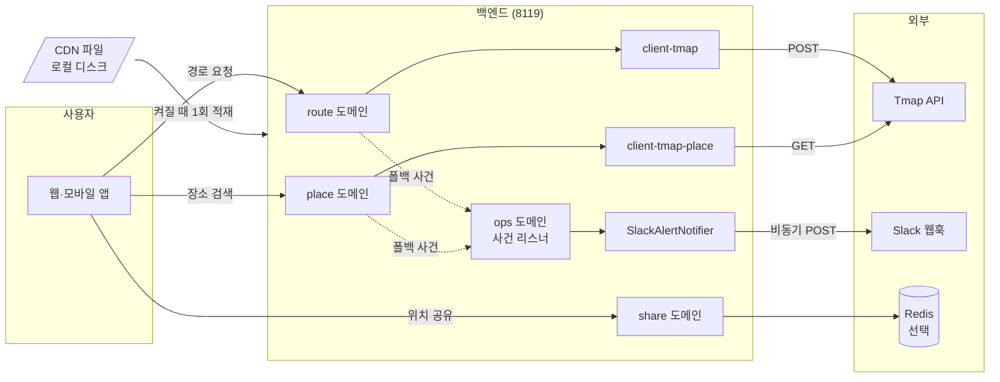
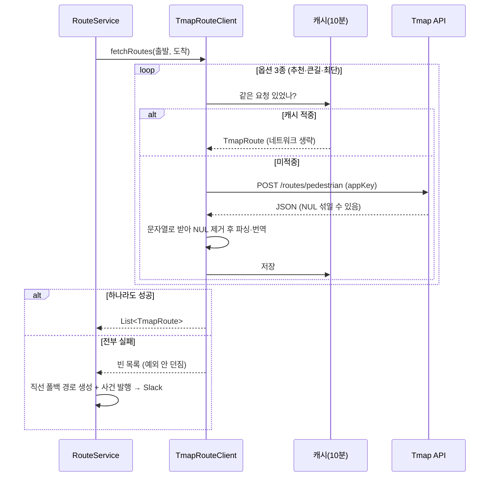
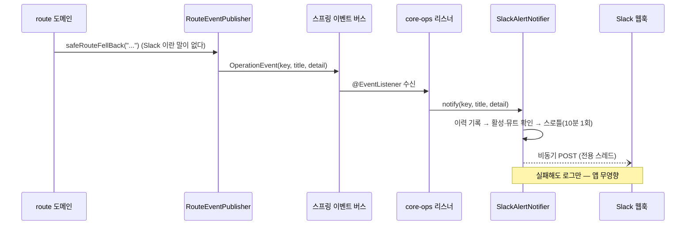

# 외부 서비스 — 언제, 무엇이, 어떻게 불리나

처음 보는 사람을 위한 지도다. 이 서버가 바깥과 주고받는 모든 접점을,
**켜질 때 → 켜진 뒤 백그라운드 → 요청이 올 때** 세 시점으로 나눠 적는다.

> 원천별 상세(인증·쿼터·필드)는 bueongi-service 저장소의 `docs/external-api-catalog.md`,
> 위치 공유 설계는 [`LOCATION_SHARING_DESIGN.md`](LOCATION_SHARING_DESIGN.md).

## 한눈 요약

**켜질 때 외부 API 호출은 없다.** 기동 중에 하는 일은 로컬 파일 읽기와 (설정했을 때만) Redis 연결뿐이다.
외부 API(Tmap·Slack)는 전부 **사용자 요청이나 사건이 있어야** 불린다.

```
켜질 때        CDN 파일 적재(로컬) · Redis 연결(선택)          ← 외부 API 없음
켜진 뒤        도착 감시 루프(60초마다, 내부 데이터만 훑음)
요청이 올 때   Tmap(경로·장소검색)
사건이 날 때   Slack(운영 알림)
```

### 전체 구조도



- **실선** = 요청이 있을 때만 흐르는 호출 · **점선** = 실패했을 때만 나는 사건.
- 켜질 때 바깥으로 나가는 것은 Redis 연결(선택)뿐이고, CDN 파일은 로컬 디스크다.

## 1. 켜질 때 — 기동 타임라인

```
main() 시작
  │
  ├─ ① 설정 검문      yml + 환경변수 바인딩. 값이 틀리면 여기서 죽는다(fail-fast).
  │                    예: 관리자 비밀번호가 bcrypt 형식이 아니면 APPLICATION FAILED TO START
  │
  ├─ ② 빈 조립
  │     ├─ 안심시설 적재   BUEONGI_FACILITY_DATA_DIR(기본 cdn)의 JSON/CSV 를 읽어
  │     │                  메모리 인덱스 구성. **로컬 파일이다 — 네트워크 아님.**
  │     │                  디렉터리가 없으면 경고 로그 후 빈 적재로 계속 뜬다.
  │     └─ Redis 연결      BUEONGI_REDIS_URL 있을 때만. 없으면 인메모리 폴백이라 연결 자체가 없다.
  │
  ├─ ③ 8119 포트 오픈 → "Started" 로그
  │
  └─ ④ 백그라운드 시작    도착 감시 루프(아래 2절)
```

과거에는 기동 1회 + 매월 cron 으로 공공데이터를 라이브 갱신했지만 **기동 때는 이제 아무것도 부르지 않는다.**
부팅을 외부 API 지연에 묶지 않기 위해서다. 기본 시설 데이터는 파이프라인이 만든 CDN 파일과
`data/source/` 의 CSV 로 들어오고, 모자란 부분은 **요청이 닿을 때 뒤에서 받는다**(2절).

어댑터가 있는데 아직 아무도 부르지 않는 것: `client-datagokr-cctv`·`-bell`(증분 갱신용 — 데이터는 CSV 로 완결) ·
`-safehouse`(여성안심지킴이집 — 아동안전지킴이집이 같은 마커를 채우고 있어 존치 재검토).

## 2. 켜진 뒤 — 백그라운드

| 무엇 | 주기 | 바깥과의 접점 |
|---|---|---|
| `MissedArrivalWatchdog` | 60초(설정 가능) | 없음 — 내부 공유 세션만 훑는다. **놓친 도착을 발견하면** 사건을 발행하고, 그 사건을 받은 쪽이 Slack 을 부른다(3절) |
| `LightingFillTrigger` | 경로 요청이 올 때마다 | **있다** — 아래 참고. 전용 `lighting-fill` 스레드 하나에서만 돌고, **요청 스레드를 절대 막지 않는다** |

### 조명 지연 적재 — `LightingFillTrigger`

경로 요청의 출발·도착 좌표가 닿은 곳의 데이터를 뒤에서 받아 채운다. 파일로 안 들어오는 종류만 해당한다.
이번 응답은 지금 있는 것으로 나가고, 다음 요청부터 채워진 데이터가 보인다.

| 종류 | 클라이언트 | 받는 단위 | 다시 받기 |
|---|---|---|---|
| 보안등 | `client-datagokr-security-lamp` | 자치단체 하나(`instt_code`) | 90일 뒤 |
| 가로등 | `client-safetydata-street-lamp` | **전국 한 덩이**(이 API 는 지역 조건을 안 받는다. 전량 2페이지라 싸다) | 90일 뒤 |
| 치안시설 | `client-safemap` | **전국 한 덩이**(전량 4페이지, 원천 갱신주기 1년) | 90일 뒤 |
| 아동안전지킴이집 | `client-safe182` | **지도 격자 한 칸**(0.1°≈11km, 원천이 사각 범위만 받음 · 일일 한도 有) | 90일 뒤 |

**이미 가진 자치단체는 받지 않는다.** 받기 전에 인덱스에 그 자치단체 데이터가 있는지 먼저 본다 —
CSV 로 들어온 7개 자치단체(창녕·김해·여주·평창·양산·함양·증평)가 여기 걸린다. 안 그러면
CSV 와 똑같은 데이터를 위해 자치단체마다 수십 회를 쓴다(창녕 실측: CSV 10,041 = API 10,041).

받은 것은 `{region-cache-dir}/{종류}/{지역코드}.json` 에 `savedAt` 과 함께 남고,
재기동 때 그대로 되읽는다. 가로등·치안시설은 지역이 없어 코드 자리에 `nationwide` 를, 지킴이집은 격자 칸 번호를 쓴다.
실패하면 사건을 발행하고 기존 데이터를 유지하되 **10분 냉각** 후에만 다시 시도한다 — 원천 장애 중 요청마다 실패 호출이 반복되지 않게(`FillFailureCooldown`).

## 3. 요청·사건이 있을 때 — 외부 서비스별

### Tmap (보행 경로) — `clients:client-tmap`

- **언제**: 사용자가 경로 비교를 요청할 때만 (`/api/routes`).
- **안 되면**: 경로 후보가 하나도 없으면 503 `ROUTE_SEARCH_UNAVAILABLE` + Slack 사건 `tmap-route-failed`. 폴백 경로는 없다.
  서버는 죽지 않는다.
- 응답 본문에 NUL(0x00)이 섞여 오는 실측 사례가 있어 문자열로 받아 다듬은 뒤 파싱한다
  (`TmapResponseText.sanitizeTmapJson`).

### Tmap POI (장소 검색) — `clients:client-tmap-place`

- **언제**: 장소 검색 요청일 때만 (`/api/places/search?keyword=…`). 키는 경로와 같은 `bueongi.tmap.app-key`(`client-tmap.yml`).
- **안 되면**: 키 미설정·호출 실패 모두 503 `PLACE_SEARCH_UNAVAILABLE` + Slack 사건 `place-search-failed`. 폴백 결과는 없다.

### Slack (운영 알림) — `clients:client-slack`

- **언제**: 사건이 났을 때만. 도메인은 Slack 을 모른다 — 사건(`OperationEvent`)을 발행하면
  `core-ops` 리스너가 받아 `SlackAlertNotifier` 로 보낸다.
- 발송 지점: 처리 못한 500 · Tmap 전면 실패 · 장소 검색 실패 · 시설 적재 0건 · 도착 미확인.
- 같은 사건 key 는 10분 창 안에서 1번만 보낸다(스로틀). `SLACK_WEBHOOK_URL` 미설정이면 전체 무발송(무해).

### Redis (위치 공유 저장) — `storage:db-share`

- **언제**: 켜질 때 연결(설정 시), 이후 공유 세션 읽기/쓰기마다.
- **안 되면**: 미설정 시 인메모리 폴백 — 단일 인스턴스·재시작 시 휘발이지만 계약은 동일.
- 외부 "API" 라기보다 우리 인프라다. 여기 적는 이유는 켜질 때 바깥에 접속하는 유일한 것이라서다.

## 4. 한 호출의 해부 — 코드가 실제로 하는 일

### 공통 기반 — 모든 외부 호출이 딛고 서는 것

```
스프링 자동구성 RestClient.Builder ──┬─→ TmapRouteClient   (clone().build())
   ↑ 전역 타임아웃이 여기 걸린다      ├─→ TmapPlaceClient  (clone().build())
                                     └─→ SlackAlertNotifier (clone().build())
```

- **타임아웃은 yml 한 곳에서 전부 적용된다** (`application.yml`): 연결 3초, 응답 10초.
  미설정이면 무한대라, 외부가 느려지는 "슬로우 장애"에서 우리 스레드가 전부 잡혀 전체 장애로 번진다.
- **키는 생성자에서 주입**받고(`@Value`), 키가 비어 있으면 `isEnabled = false` — **호출 자체를 안 한다.**
- **통신 응답 모양(JSON 구조)은 clients 모듈 밖으로 안 나간다.**
  - 경로: 클라이언트가 외부 JSON 을 자기 타입(`TmapRoute`)으로 받아 내보내고, core 의 경계 한 곳(`RouteFinder`)이
    도메인 모델 `RouteCandidate`·`NavigationStep` 으로 바꾼다. Tmap 을 아는 core 파일은 그 하나다(`RouteTmapBoundaryTest` 가 지킨다).
  - 장소: core 는 Tmap 을 모른다. 계약 모듈 `clients:client-place` 의 `PlaceSearchClient`·`Place` 만 알고,
    `clients:client-tmap-place` 의 `TmapPlaceClient` 가 그 계약을 구현한다. 공급자를 바꾸면 계약을 구현한 새 clients 모듈을 만들고
    `core-app` 의 의존 한 줄(새 모듈이 자기 yml 을 가지면 `application.yml` import 한 줄도)을 바꾼다 — core 와 core 의 테스트는 그대로다.
    장소 구현을 경로용 `client-tmap` 과 다른 모듈에 둔 이유: `client-tmap` 은 core-route 때문에 늘 클래스패스에 남아,
    그 안에 장소 구현이 있으면 새 공급자와 `PlaceSearchClient` 빈이 둘이 되어 부팅이 멈춘다.

### Tmap 경로 — 요청 한 번의 여정

사용자가 경로 비교를 누르면:




```
RouteService ─→ TmapRouteClient.fetchRoutes(출발, 도착)
                  │  옵션 3종("추천 0"·"큰길 4"·"최단 10")을 하나씩 → 최대 3회 POST
                  ▼
    ① 캐시 확인      같은 출발·도착·옵션이 10분 안에 있으면 네트워크 생략
    ② POST 요청      https://apis.openapi.sk.com/tmap/routes/pedestrian?version=1
                     헤더 appKey — 로그·예외에는 절대 안 실림
    ③ 문자열로 수신   ★ 바로 객체로 안 받는다. Tmap 이 본문에 NUL(0x00)을 섞어 보내는
                     실측 사례가 있어, sanitizeTmapJson 으로 다듬은 뒤 파싱한다
    ④ 번역           GeoJSON → TmapRoute (거리·시간·좌표열·안내점)
    ⑤ 실패하면       예외를 위로 안 던진다 — null 반환 + 원인 사슬 로그
                     ("A: msg <- B: msg" — 겉 메시지만 남기면 진짜 원인이 사라진 사건의 교훈)
```

세 옵션이 **전부** null 이면 `RouteOptionService` 가 `RouteSearchUnavailableException` 을 던져
503 `ROUTE_SEARCH_UNAVAILABLE`("지금은 경로를 찾을 수 없습니다")로 응답한다. 폴백 경로는 만들지 않는다.
그 오류 응답이 사건이 되어 `ApiErrorEventListener` 가 `tmap-route-failed`(`AlertCategory.ROUTE_SEARCH_FAILED`) 알림을 보낸다 → Slack.

### 장소 검색 — 계약 → 호출

```
PlaceSearchService.search(키워드)          ← core 는 PlaceSearchClient 계약만 안다
    │
    └─ TmapPlaceClient.search ─→ GET apis.openapi.sk.com/tmap/pois?searchKeyword=…&count=15
                                   헤더 appKey: ***
                                   │
                                   ├─ 성공 → 응답을 Place 로 번역해 반환 → PlaceResponse
                                   └─ 키 없음·예외 → PlaceSearchUnavailableException(503) → 사건 place-search-failed → Slack
```

### Slack 알림 — 도메인은 Slack 을 모른다



```
도메인 코드          route 도메인: routeEvents.safeRouteFellBack("…")     ← Slack 이란 말이 없다
    │                (도메인마다 발행 전용 서비스 XxxEventPublisher)
    ▼
스프링 이벤트        OperationEvent(key, title, detail) 발행
    ▼
core-ops 리스너      받아서 AlertNotifier.notify(key, …) 호출
    ▼
SlackAlertNotifier   ① 이력 기록(발송 여부와 무관하게 남김)
                     ② 웹훅 미설정·뮤트 카테고리면 여기서 끝(무해)
                     ③ 같은 key 는 10분에 1번만(스로틀) — 장애 중 알림 폭주 방지
                     ④ 전용 단일 스레드로 비동기 발송 — 사용자 요청 스레드를 안 막는다
                     ⑤ 발송 실패해도 로그만 남기고 앱은 무영향
```

### 설계 원칙 한 줄 요약

| 원칙 | 코드에서 |
|---|---|
| 키 없으면 안 부른다 | `isEnabled` 게이트 |
| 실패를 위로 안 던진다 | null/폴백 + 사건 발행 |
| 느린 외부에 안 끌려간다 | 전역 타임아웃 3s/10s |
| 통신 모양은 모듈 안에 | 클라이언트가 우리 말로 번역 |
| 원인을 잃지 않는다 | cause 사슬 로그 |
| 시크릿은 어디에도 | appKey·웹훅 URL 비로그 |

## 5. 지금 상태를 확인하는 법

```bash
curl -s localhost:8119/api/health
# {"status":"UP","service":"bueongi-backend","locationStore":"redis|memory"}
```

- `locationStore: redis` = Redis 연결됨 / `memory` = 인메모리 폴백.

## 6. 요약 표

| 서비스 | 켜질 때 | 부르는 조건 | 실패 시 |
|---|---|---|---|
| CDN 파일(시설) | **읽음(로컬)** | 기동 1회 | 경고 로그 + 빈 적재로 기동 |
| Redis | 연결(설정 시) | 공유 세션 I/O | 인메모리 폴백 |
| Tmap | 안 부름 | 경로 요청 | 폴백 경로 + Slack |
| Tmap 장소 | 안 부름 | 장소 검색 요청 | 503 + Slack |
| Slack | 안 부름 | 사건 발생 | 로그만 (알림 유실) |
