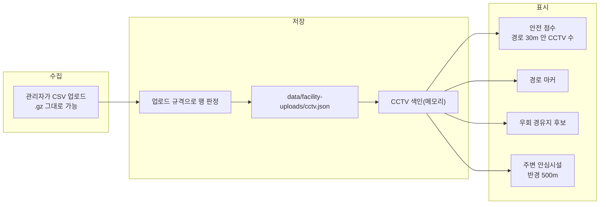

# CCTV: 데이터 수집과 표시

CCTV 데이터가 어디서 와서 어떻게 저장되고 어디에 보이는지 정리한다. 여러 시설에 공통인 저장 구조는
[DATA_STORAGE.md](../DATA_STORAGE.md)를 본다.

> 기준: 2026-11-25, 브랜치 `feat/nearby-safety-spot-counts` 
> 건수: `data/source` 원본을 실제 업로드 파서로 읽어 센 값

## 한눈에 보기

| 항목          | 내용                                             |
|---------------|--------------------------------------------------|
| 원천          | 공공데이터포털 전국 CCTV 표준데이터              |
| 들어오는 길   | 관리자 CSV 업로드                                |
| 외부 API 수집 | 없음                                             |
| 원본 CSV      | `data/source/cctv/CCTV정보.csv.gz` (CP949)       |
| 적재          | 377,278행 중 319,164행                           |
| 쓰는 곳       | 안전 점수, 경로 마커, 우회 경유지, 주변 안심시설 |

## CSV 필드

원본에는 18개 필드가 있고, 서버는 그중 6개를 읽는다.

| 필드             | 예시                           | 서버가 읽는 용도         |
|------------------|--------------------------------|--------------------------|
| 개방자치단체코드 | `3000000`                      | 지역 코드                |
| 관리번호         | `202630000000800991`           | -                        |
| 관리기관명       | 서울특별시 종로구청            | 이름                     |
| 소재지도로명주소 | 서울특별시 종로구 숭인동2길 30 | -                        |
| 소재지지번주소   | (빈 칸)                        | 주소                     |
| 설치목적구분     | 생활방범                       | 거르기(방범 목적만)      |
| 카메라대수       | `3`                            | 카메라 수(0 이하는 없음) |
| 카메라화소수     | `200`                          | -                        |
| 촬영방면정보     | 360도 전방면                   | -                        |
| 보관일수         | `30`                           | -                        |
| 설치연월         | `201312`                       | -                        |
| 관리기관전화번호 | 02-2148-3033                   | -                        |
| WGS84위도        | `37.57814`                     | 좌표(위도)               |
| WGS84경도        | `127.0202`                     | 좌표(경도)               |
| 데이터기준일자   | 2026-05-18                     | -                        |
| 데이터갱신구분   | (빈 칸)                        | -                        |
| 데이터갱신시점   | 2026-05-19 22:58:23            | -                        |
| 최종수정시점     | 2026-05-18 15:24:22            | -                        |

## 흐름

- 업로드하면 색인을 바로 바꾸고, 서버가 다시 켜질 때는 `cctv.json`을 읽어 색인을 만든다.
- 좌표가 같은 CCTV는 색인에서 하나로 합친다(2026-10-11 측정 212,932곳).
- 원본 CSV(`data/source`)는 서버가 직접 읽지 않는다. 관리자 CSV 목록(`GET /api/admin/safety-spot-csv-files`)에 보관본으로만
  나온다.

## 읽는 규칙

업로드 규격은 `core-admin-safety-spot`의 `CctvCsvContract`다.

1. 좌표는 `WGS84위도`, `WGS84경도`를 읽는다. 둘 중 하나가 없으면 그 행을 버린다.
2. `설치목적구분`이 생활방범, 다목적, 어린이보호, 차량방범인 행만 남긴다.
3. 이름은 `관리기관명`, 주소는 `소재지지번주소`, 카메라 수는 `카메라대수`를 쓴다.

## 갱신 방법

1. 공공데이터포털에서 새 판 CSV를 받는다.
2. 관리자 화면에서 CCTV로 업로드한다. 교체 시각과 건수가 관리자 화면에 남는다.
3. 받은 파일을 `data/source/cctv/`에 `.gz`로 보관한다.

공공데이터포털의 CCTV 조회 API(`cctv_info`)는 실측에서 쓸 수 없어 붙이지 않았다.

## 알아둘 점

- 주소는 `소재지지번주소`만 읽는다. 지번주소가 빈 행이 많아(예시 행도 비어 있음) 주소가 빈 마커가 생긴다.
  `소재지도로명주소`는 읽지 않는다.
- 업로드 결과(`data/facility-uploads`)는 실행 중에 생기는 파일이다. 운영 docker-compose에 볼륨이 없어 컨테이너를 새로
  만들면 사라진다.
