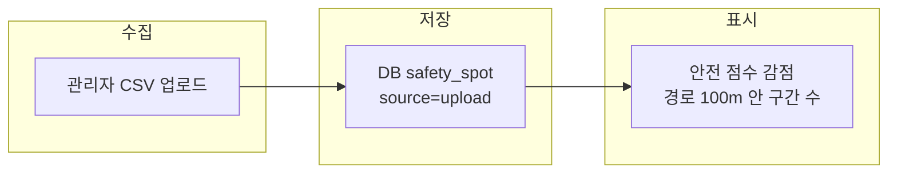

# 범죄주의구간: 데이터 수집과 표시

범죄주의구간 데이터가 어떻게 들어오고 어디에 쓰이는지 정리한다. 여러 시설에 공통인 저장 구조는
[DATA_STORAGE.md](../DATA_STORAGE.md)를 본다.

> 기준: 2026-11-25, 브랜치 `feat/nearby-safety-spot-counts`

## 한눈에 보기

| 항목          | 내용                                   |
|---------------|----------------------------------------|
| 원천          | 정해지지 않음                          |
| 들어오는 길   | 관리자 CSV 업로드                      |
| 외부 API 수집 | 없음                                   |
| 원본 CSV      | 저장소에 없음                          |
| 적재          | 0건 (아직 올린 데이터가 없음)          |
| 쓰는 곳       | 안전 점수 감점만 (지도에는 표시 안 함) |

범죄주의구간은 안심시설이 아니라 위험 신호다. 경로 점수를 깎는 데만 쓰고 마커나 주변 안심시설로는 내보내지 않는다.

## CSV 필드

원본 CSV가 저장소에 없다. 업로드 규격(`CrimeProneAreaCsvFormat`)이 읽는 필드는 다음과 같다.

| 필드                         | 서버가 읽는 용도 |
|------------------------------|------------------|
| `위도`                       | 좌표(위도)       |
| `경도`                       | 좌표(경도)       |
| `시설명` 또는 `지역명`       | 이름             |
| `주소` 또는 `소재지지번주소` | 주소             |

## 흐름

다른 시설은 경로 30m 안을 세지만, 범죄주의구간은 경로 100m 안을 센다.

## 갱신 방법

1. 좌표가 있는 범죄주의구간 CSV를 구한다.
2. 관리자 화면에서 범죄주의구간으로 업로드한다.

## 알아둘 점

- 데이터가 0건이라 지금은 감점이 한 번도 일어나지 않는다.
- 원천이 정해지지 않았다. 원천을 정할 때 좌표 필드 이름이 `위도`, `경도`인지 먼저 확인한다.
