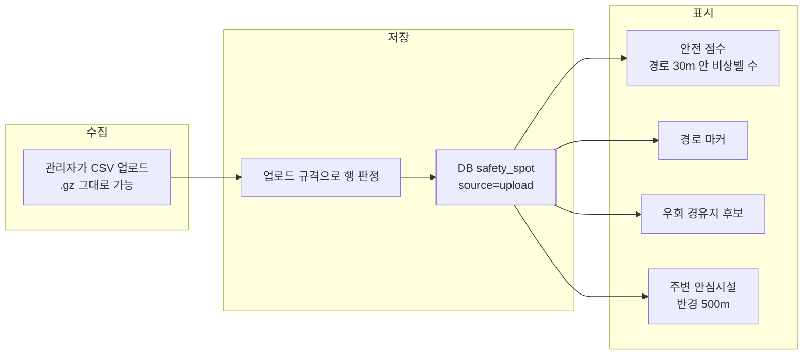

# 비상벨: 데이터 수집과 표시

안전비상벨 데이터가 어디서 와서 어떻게 저장되고 어디에 보이는지 정리한다. 여러 시설에 공통인 저장 구조는
[DATA_STORAGE.md](../DATA_STORAGE.md)를 본다.

> 기준: 2026-11-25, 브랜치 `feat/nearby-safety-spot-counts` 
> 건수: `data/source` 원본을 관리자 업로드 API로 올려 센 값

## 한눈에 보기

| 항목          | 내용                                                 |
|---------------|------------------------------------------------------|
| 원천          | 공공데이터포털 안전비상벨 위치정보                   |
| 들어오는 길   | 관리자 CSV 업로드                                    |
| 외부 API 수집 | 없음                                                 |
| 원본 CSV      | `data/source/bell/안전비상벨위치정보.csv.gz` (CP949) |
| 적재          | 88,634행 중 88,621행, 같은 좌표를 합쳐 75,056곳      |
| 쓰는 곳       | 안전 점수, 경로 마커, 우회 경유지, 주변 안심시설     |

## CSV 필드

원본에는 24개 필드가 있고, 서버는 그중 5개를 읽는다.

| 필드               | 예시                               | 서버가 읽는 용도 |
|--------------------|------------------------------------|------------------|
| 개방자치단체코드   | `3000000`                          | 지역 코드        |
| 관리번호           | `202630000000900002`               | -                |
| 안전비상벨관리번호 | 화장실-002호                       | -                |
| 설치목적           | 약자보호                           | -                |
| 설치장소유형       | 화장실                             | -                |
| 설치위치           | 서울시 종로구 보건소 화장실        | 이름             |
| 소재지도로명주소   | 서울특별시 종로구 자하문로 19길 36 | -                |
| 소재지지번주소     | 서울특별시 종로구 옥인동 45-30     | 주소             |
| WGS84위도          | `37.5732`                          | 좌표(위도)       |
| WGS84경도          | `127.0016`                         | 좌표(경도)       |
| 연계방식           | 양방향                             | -                |
| 경찰연계유무       | `N`                                | -                |
| 경비업체연계유무   | `N`                                | -                |
| 관리사무소연계유무 | `Y`                                | -                |
| 부가기능           | 통화, 경보                         | -                |
| 안전비상벨설치연도 | `2024`                             | -                |
| 최종점검일자       | 2026-05-18                         | -                |
| 최종점검결과구분   | `Y`                                | -                |
| 관리기관명         | 종로구 보건소 보건정책과           | -                |
| 관리기관전화번호   | 02-2148-3516                       | -                |
| 데이터기준일자     | 2026-05-18                         | -                |
| 데이터갱신구분     | (빈 칸)                            | -                |
| 데이터갱신시점     | 2026-05-19 22:58:29                | -                |
| 최종수정시점       | 2026-05-18 15:26:20                | -                |

## 흐름

- 업로드하면 DB의 비상벨 `upload` 조각을 한 트랜잭션으로 바로 바꾼다. 재시작해도 DB에 남는다.
- 2026-11-25 실제 원본 업로드에서 88,621행이 3.6초에 들어갔다.
- 업로드가 없을 때만 서버가 켜질 때 `cdn/emergency_bell/nationwide.json`(변환 스크립트 `data/ingest/bell_ingest.py`의
  결과)을 DB의 `cdn` 조각으로 옮긴다. 이 파일은 `.gitignore` 대상이라 저장소에 없다.

## 읽는 규칙

업로드 규격은 `core-admin-safety-spot`의 `BellCsvContract`다.

1. 좌표는 `WGS84위도`, `WGS84경도`(없으면 `위도`, `경도`)를 읽는다. 둘 다 없으면 옛 판의 `X좌표`, `Y좌표`(EPSG:5174)를
   위경도로 바꾼다. 좌표가 빈 행은 버린다.
2. 이름은 `설치위치`(없으면 `설치장소`), 주소는 `소재지지번주소`, 지역 코드는 `개방자치단체코드`를 쓴다.

## 갱신 방법

1. 공공데이터포털에서 새 판 CSV를 받는다.
2. 관리자 화면에서 비상벨로 업로드한다. 교체 시각과 건수가 관리자 화면에 남는다.
3. 받은 파일을 `data/source/bell/`에 `.gz`로 보관한다.

## 알아둘 점

- 2026-11-25 전에는 원본 CSV를 업로드하면 0건이 들어갔다. 업로드 규격이 `WGS84위도`, `WGS84경도`, `설치위치`를 찾지
  않았기 때문이고, 지금은 고쳐졌다.
- 업로드한 시설은 DB(운영 compose의 `db-data` 볼륨)에 남는다. 관리자 미리보기용 원본 CSV
  (`data/facility-uploads/originals/emergency_bell.csv`)만 컨테이너 안 파일이라 컨테이너를 새로 만들면 사라진다.
