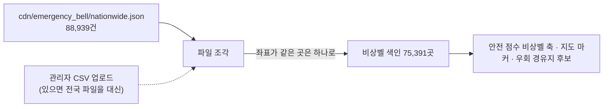

# 비상벨 — 데이터 저장

공통 구조(디스크 → 조각 → 색인)는 [DATA_STORAGE.md](../DATA_STORAGE.md) 에 있다. 이 문서는 비상벨 만 다룬다.

숫자는 2026-10-11 샘플 삭제 뒤 로컬 서버 기동 로그와 저장소 파일을 세어 확인한 값이다.

## 한 줄 요약

파이프라인이 넣은 **전국 비상벨 파일 하나**(88,939건)가 실데이터다. 외부 API 수집은 없다. 와이어 이름은 `emergency_bell` 이다.

## 어디서 오나



| 출처 | 위치 | 건수 | 실데이터인가 |
|---|---|---|---|
| 전국안전비상벨 표준데이터 | `cdn/emergency_bell/nationwide.json` | 88,939 | 예 |

88,939건이 75,391곳으로 준 것은 같은 좌표에 여러 행이 있기 때문이다. 예를 들어 첫 두 행이 둘 다 "서울시 종로구 보건소 화장실", 같은 주소다.

## 언제 바뀌나

실행 중에 바뀌는 길은 관리자 업로드 하나다. 공공데이터포털의 비상벨 조회 API 는 실측에서 쓸 수 없었다(`docs/external-api-catalog.md:18`, `emergency_call_box_info` "불가").

업로드 CSV 는 좌표계가 EPSG:5174(옛 한국 측지계 평면좌표)라 서버가 위경도로 바꿔 받는다.

```kotlin
// domain/csv/bell/BellCsvContract.kt (발췌)
class BellCsvContract : SafetySpotCsvContract(
    type = SafetySpotType.BELL,
    coordSystem = SafetySpotCoordSystem.EPSG5174,
    nameHeaders = listOf("설치장소"),
    addressHeaders = listOf("소재지지번주소"),
)
```

## 어디에 쓰이나

안전 점수의 비상벨 축, 지도 마커, 우회 경유지 후보에 쓴다.

```kotlin
// SafetyScorer.kt:111
bell = countWithinCorridor(SafetySpotType.BELL, path),
```

## 이 방식이 맞는가

**맞는 점** — 비상벨은 설치 후 거의 바뀌지 않고 전국 표준 파일 하나로 나온다. 파일을 읽어 메모리에 두는 방식이 맞다.

**문제 — 언제 기준 데이터인지 모른다.** `nationwide.json` 에는 `generatedAt`(만든 시각)이 없다. 다른 CDN 파일에는 있다.

**권장** — `nationwide.json` 을 다시 만들 때 생성 시각과 원본 기준일을 함께 기록한다(권장).
