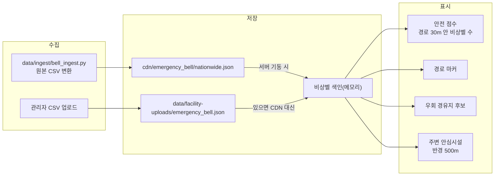

# 비상벨: 데이터 수집과 표시

안전비상벨 데이터가 어디서 와서 어떻게 저장되고 어디에 보이는지 정리한다. 여러 시설에 공통인 저장 구조는
[DATA_STORAGE.md](../DATA_STORAGE.md)를 본다.

> 기준: 2026-11-25, 브랜치 `feat/nearby-safety-spot-counts` 
> 건수: `data/source` 원본을 실제 업로드 파서로 읽어 센 값

## 한눈에 보기

| 항목          | 내용                                                 |
|---------------|------------------------------------------------------|
| 원천          | 공공데이터포털 안전비상벨 위치정보                   |
| 들어오는 길   | CDN 파일(변환 스크립트) 또는 관리자 CSV 업로드       |
| 외부 API 수집 | 없음                                                 |
| 원본 CSV      | `data/source/bell/안전비상벨위치정보.csv.gz` (CP949) |
| 적재          | 업로드로는 88,634행 중 0행 (아래 "알아둘 점")        |
| 쓰는 곳       | 안전 점수, 경로 마커, 우회 경유지, 주변 안심시설     |

## CSV 필드

원본에는 24개 필드가 있다. 서버 쪽 읽는 용도는 두 경로가 다르다.

| 필드               | 예시                               | 변환 스크립트 | 업로드 규격 |
|--------------------|------------------------------------|---------------|-------------|
| 개방자치단체코드   | `3000000`                          | -             | 지역 코드   |
| 관리번호           | `202630000000900002`               | -             | -           |
| 안전비상벨관리번호 | 화장실-002호                       | -             | -           |
| 설치목적           | 약자보호                           | -             | -           |
| 설치장소유형       | 화장실                             | -             | -           |
| 설치위치           | 서울시 종로구 보건소 화장실        | 이름          | -           |
| 소재지도로명주소   | 서울특별시 종로구 자하문로 19길 36 | -             | -           |
| 소재지지번주소     | 서울특별시 종로구 옥인동 45-30     | -             | 주소        |
| WGS84위도          | `37.5732`                          | 좌표(위도)    | 읽지 못함   |
| WGS84경도          | `127.0016`                         | 좌표(경도)    | 읽지 못함   |
| 연계방식           | 양방향                             | -             | -           |
| 경찰연계유무       | `N`                                | -             | -           |
| 경비업체연계유무   | `N`                                | -             | -           |
| 관리사무소연계유무 | `Y`                                | -             | -           |
| 부가기능           | 통화, 경보                         | -             | -           |
| 안전비상벨설치연도 | `2024`                             | -             | -           |
| 최종점검일자       | 2026-05-18                         | -             | -           |
| 최종점검결과구분   | `Y`                                | -             | -           |
| 관리기관명         | 종로구 보건소 보건정책과           | 이름 보조     | -           |
| 관리기관전화번호   | 02-2148-3516                       | -             | -           |
| 데이터기준일자     | 2026-05-18                         | -             | -           |
| 데이터갱신구분     | (빈 칸)                            | -             | -           |
| 데이터갱신시점     | 2026-05-19 22:58:29                | -             | -           |
| 최종수정시점       | 2026-05-18 15:26:20                | -             | -           |

## 흐름

- 서버는 켜질 때 CDN 파일을 읽고, 업로드 파일이 있으면 그것으로 CDN 파일을 대신한다.
- `cdn/emergency_bell/nationwide.json`은 `.gitignore` 대상이라 저장소에 없다. 변환 스크립트를 돌려 만든다.

## 읽는 규칙

**변환 스크립트**(`data/ingest/bell_ingest.py`)는 `WGS84위도`, `WGS84경도`, `설치위치`, `관리기관명`을 읽어 CDN JSON을
만든다.

**업로드 규격**(`BellCsvContract`)은 다음을 기대한다.

1. 좌표는 `위도`, `경도`를 먼저 찾고, 없으면 `X좌표`, `Y좌표`(EPSG:5174)를 찾는다.
2. 이름은 `설치장소`, 주소는 `소재지지번주소`를 쓴다.

## 갱신 방법

지금 실제로 동작하는 길은 변환 스크립트다.

1. 공공데이터포털에서 새 판 CSV를 받아 `data/source/bell/`에 `.gz`로 보관한다.
2. `data/ingest/README.md`의 절차대로 변환 스크립트를 돌려 `nationwide.json`을 만든다.
3. 서버를 다시 켠다.

## 알아둘 점

- **원본 CSV를 업로드하면 0건이 들어간다.** 원본의 좌표 필드 이름은 `WGS84위도`, `WGS84경도`인데, 업로드 규격은
  `위도`, `경도`나 `X좌표`, `Y좌표`만 찾는다. 이름 필드 `설치장소`도 원본에 없다(원본은 `설치장소유형`, `설치위치`).
  CCTV 규격처럼 `WGS84위도`, `WGS84경도`를 후보에 넣으면 해결된다.
- 원본 CSV는 88,634행, 2026-10-11에 측정한 CDN 파일은 88,939건으로 서로 다르다. 만든 시점의 원본이 다른 것으로 보이며
  확인하지 못했다.
