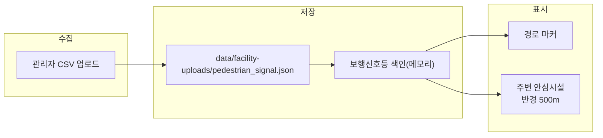

# 보행신호등: 데이터 수집과 표시

보행신호등 데이터가 어떻게 들어오고 어디에 보이는지 정리한다. 여러 시설에 공통인 저장 구조는
[DATA_STORAGE.md](../DATA_STORAGE.md)를 본다.

> 기준: 2026-11-25, 브랜치 `feat/nearby-safety-spot-counts`

## 한눈에 보기

| 항목          | 내용                                      |
|---------------|-------------------------------------------|
| 원천          | 서울 열린데이터광장 보행등(OA-22354)      |
| 들어오는 길   | 관리자 CSV 업로드                         |
| 외부 API 수집 | 없음                                      |
| 원본 CSV      | 저장소에 없음                             |
| 적재          | 0건 (아직 올린 데이터가 없음)             |
| 쓰는 곳       | 경로 마커, 주변 안심시설 (안전 점수 제외) |

보행등은 이름과 달리 조명이 아니라 보행자 신호등이다. 조명으로 넣으면 조명 밀도 점수가 부풀어서 별도 종류로 두고,
안전 점수에는 넣지 않는다.

## CSV 필드

원본 CSV가 저장소에 없다. 업로드 규격(`PedestrianSignalCsvContract`)이 읽는 필드는 다음과 같다.

| 필드                            | 서버가 읽는 용도 |
|---------------------------------|------------------|
| `위도`                          | 좌표(위도)       |
| `경도`                          | 좌표(경도)       |
| `신호등 종류` 또는 `신호등종류` | 이름             |
| `주소` 또는 `소재지지번주소`    | 주소             |

## 흐름

## 갱신 방법

1. 서울 열린데이터광장에서 보행등 CSV를 받는다.
2. 관리자 화면에서 보행신호등으로 업로드한다.

## 알아둘 점

- 데이터를 올리기 전까지 마커와 주변 안심시설에 보행신호등이 나오지 않는다.
- 받은 파일의 좌표 필드 이름이 `위도`, `경도`가 아니면 0건이 들어간다. 올린 뒤 관리자 화면의 적재 건수를 확인한다.
