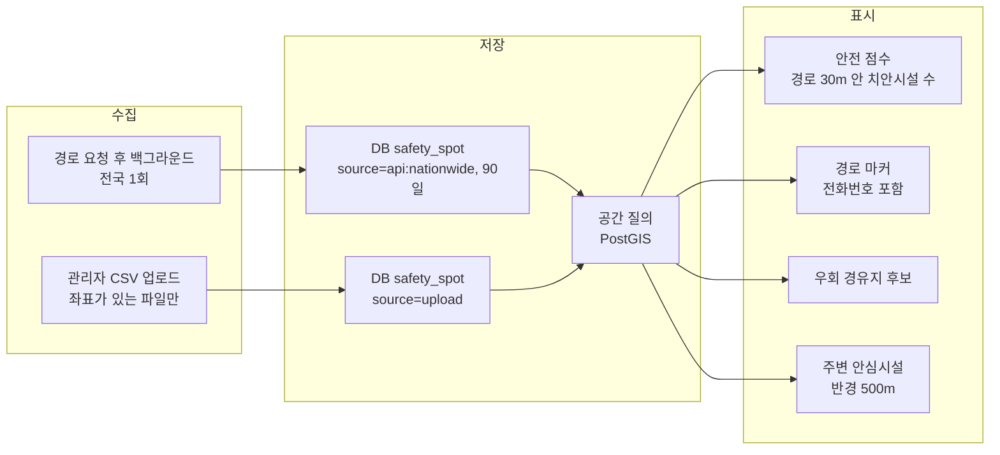

# 치안시설(경찰): 데이터 수집과 표시

지구대, 파출소, 치안센터 데이터가 어디서 와서 어떻게 저장되고 어디에 보이는지 정리한다. 여러 시설에 공통인 저장 구조는
[DATA_STORAGE.md](../DATA_STORAGE.md)를 본다.

> 기준: 2026-11-25, 브랜치 `feat/nearby-safety-spot-counts` 
> 건수: `data/source` 원본을 실제 업로드 파서로 읽어 센 값

## 한눈에 보기

| 항목          | 내용                                                                     |
|---------------|--------------------------------------------------------------------------|
| 원천          | 경찰청 생활안전지도 치안시설                                             |
| 들어오는 길   | 경로 요청 시 외부 API 전국 1회 (관리자 CSV 업로드도 가능)                |
| 외부 API 수집 | 생활안전지도 `/openapi2/IF_0036` (전국)                                  |
| 원본 CSV      | `data/source/police/경찰청_전국 지구대 파출소 주소 현황_20251231.csv.gz` |
| 적재          | 업로드로는 2,047행 중 0행 (좌표 필드 없음)                               |
| 쓰는 곳       | 안전 점수, 경로 마커, 우회 경유지, 주변 안심시설                         |

## 필드

저장소의 원본 CSV에는 6개 필드가 있고 좌표가 없다. 그래서 이 파일은 업로드해도 들어가지 않는다.

| 필드   | 예시                          | 서버가 읽는 용도 |
|--------|-------------------------------|------------------|
| 연번   | `1`                           | -                |
| 시도청 | 서울청                        | -                |
| 경찰서 | 서울중부                      | -                |
| 관서명 | 을지                          | 이름             |
| 구분   | 지구대                        | -                |
| 주소   | 서울특별시 중구 퇴계로49길 13 | 주소             |

실제 데이터는 외부 API로 들어온다. API 응답에서 읽는 필드는 다음과 같다.

| API 필드   | 서버가 읽는 용도         |
|------------|--------------------------|
| `x`, `y`   | 좌표(EPSG:3857 평면좌표) |
| `fclty_nm` | 이름                     |
| `rn_adres` | 주소                     |
| `telno`    | 전화번호                 |
| `sgg_cd`   | 지역 코드                |

## 흐름

- 외부 API는 경로 요청이 처음 들어올 때 전국을 한 번 받아 DB의 `api:nationwide` 조각으로 넣는다. 그 조각의 저장
  시각(`safety_spot_slice.saved_at`)이 90일 안이면 부르지 않고, 실패하면 10분 동안 다시 부르지 않는다.
- 경로 마커에 전화번호가 함께 나간다(`SafetySpotPoi.phone`). 다른 시설은 전화번호가 빈 문자열이다.

## 읽는 규칙

- 외부 API 좌표는 평면좌표라 위경도로 바꾼다. 바꾼 결과가 한국 범위 밖이면 버린다. 값 없음을 뜻하는 `-`는 빈 값으로 본다.
- 업로드 규격(`PoliceCsvContract`)은 `위도`, `경도`나 `X좌표`, `Y좌표`(EPSG:5179)를 찾는다. 이름은 `시설명` 또는
  `관서명`, 주소는 `주소` 또는 `소재지도로명주소`, 전화는 `전화번호`를 쓴다.

## 갱신 방법

따로 할 일이 없다. 90일이 지나면 다음 경로 요청 때 다시 받는다. 생활안전지도의 갱신 주기가 1년이라 충분하다.

## 알아둘 점

- 키(`SAFEMAP_SERVICE_KEY`)가 없으면 치안시설은 0건이다. 저장소의 원본 CSV는 좌표가 없어 대신 쓸 수 없다.
- CSV만으로 운영하려면 좌표가 있는 파일(생활안전지도 파일 내려받기 등)을 구해야 한다.
