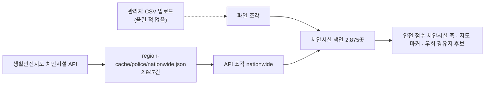

# 치안시설 — 데이터 저장

공통 구조(디스크 → 조각 → 색인)는 [DATA_STORAGE.md](../DATA_STORAGE.md) 에 있다. 이 문서는 치안시설 만 다룬다.

숫자는 2026-10-11 샘플 삭제 뒤 로컬 서버 기동 로그와 저장소 파일을 세어 확인한 값이다.

## 한 줄 요약

생활안전지도(safemap.go.kr) **API 로 전국 지구대·파출소·치안센터를 한 번에** 받는다(2,947건).

## 어디서 오나



| 출처 | 위치 | 건수 | 실데이터인가 |
|---|---|---|---|
| 생활안전지도 API | `backend/data/region-cache/police/nationwide.json` | 2,947 | 예 |

클라이언트가 마지막 페이지까지 넘겨 받는다(한 페이지 1,000건, 최대 50쪽, `SafemapPoliceClient.kt:37`).

## 언제 바뀌나

가로등과 같다. 경로를 찾을 때마다 시도하되 90일 안이면 건너뛰고, 지나면 `nationwide` 조각을 새 결과로 바꾼다.

```kotlin
// PoliceFillService.kt:64-69 (발췌)
cache.save(SafetySpotType.POLICE, NATIONWIDE, points)
…
liveStore.replaceRegion(SafetySpotType.POLICE, NATIONWIDE, points)
```

업로드 CSV 는 좌표계가 EPSG:5179(국토지리정보원 평면좌표)다(`domain/csv/police/PoliceCsvContract.kt`).

## 어디에 쓰이나

안전 점수의 치안시설 축, 지도 마커(전화번호 포함), 우회 경유지 후보에 쓴다.

## 이 방식이 맞는가

**맞는 점** — 전국 3천 건 정도라 한 번에 받는 것이 가장 단순하다. 90일마다 통째로 새로 받아도 부담이 없다.

**문제는 없다.** 예전에는 실제 지구대 이름("역삼지구대")을 단 샘플 3곳이 섞여 있었으나 2026-10-11 에 지웠다.
