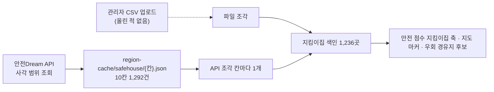

# 아동안전지킴이집 — 데이터 저장

공통 구조(디스크 → 조각 → 색인)는 [DATA_STORAGE.md](../DATA_STORAGE.md) 에 있다. 이 문서는 아동안전지킴이집 만 다룬다.

숫자는 2026-10-11 샘플 삭제 뒤 로컬 서버 기동 로그와 저장소 파일을 세어 확인한 값이다.

## 한 줄 요약

실데이터는 안전Dream(safe182.go.kr) **API 로 경로가 지나는 지도 칸마다** 받는다. 서버 안에 전국 파일은 없다.

## 어디서 오나



| 출처 | 위치 | 건수 | 실데이터인가 |
|---|---|---|---|
| 안전Dream API | `backend/data/region-cache/safehouse/{칸}.json` | 10칸, 1,292건 | 예 |

이 API 는 지역 코드를 받지 않고 위경도 사각 범위만 받는다. 그래서 지도를 0.1°(약 11km) 칸으로 나눠 칸마다 받는다. 칸 이름은 `위도칸_경도칸` 이다(예: `352_1288`).

```kotlin
// MapTile.kt (발췌) — 위경도를 0.1° 칸 번호로 바꾼다
const val SIZE_DEGREES: Double = 0.1
val code: String
    get() = "${latCell}_$lngCell"
```

## 언제 바뀌나

경로를 찾으면 경로 위 좌표가 속한 칸을 모아, 90일 안에 받지 않은 칸만 받는다. 받은 결과는 그 칸 조각만 바꾼다.

```kotlin
// ChildSafeHouseFillService.kt:64-68 (발췌)
cache.save(SafetySpotType.SAFEHOUSE, tile.code, points)
…
liveStore.replaceRegion(SafetySpotType.SAFEHOUSE, tile.code, points)
```

## 어디에 쓰이나

안전 점수의 지킴이집 축, 지도 마커, 우회 경유지 후보에 쓴다.

## 이 방식이 맞는가

**맞는 점** — API 가 범위로만 조회되므로 고정 칸으로 나눠 받는 것이 맞다. 칸 크기가 고정이라 같은 곳을 두 번 받지 않는다.

**문제 1 — 경로가 지나간 칸만 데이터가 있다.** 관리자 화면에서 지킴이집이 0인 지역은 "없음"이 아니라 "아직 받지 않음"일 수 있다.

**문제 2 — 처음 가는 칸의 첫 요청에는 데이터가 없다.** 이 종류는 서버 안에 대신할 전국 파일이 없어서 영향이 가장 크다.

서버는 경로를 찾을 때 API 수집을 **뒤에서(기다리지 않고)** 시작한다. 그래서 처음 가는 지역의 첫 경로 응답에는 그 지역 API 데이터가 아직 없을 수 있다.

```kotlin
// SafeRouteService.kt:38 — 수집을 맡기고 바로 점수 계산으로 넘어간다
routePlannedHandler.onRoutePlanned(firstRoutePath)

// SafetySpotFillTrigger.kt:38 — 실제 수집은 별도 스레드에서 돈다
executor.execute {
```

**권장** — 첫 요청 문제는 자주 쓰는 지역의 칸을 서버가 켜질 때 미리 받는 것으로 줄일 수 있다(권장, 외부 호출 수가 늘어나는 대가가 있다).
