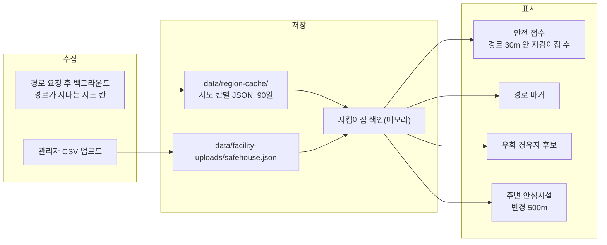

# 아동안전지킴이집: 데이터 수집과 표시

아동안전지킴이집 데이터가 어디서 와서 어떻게 저장되고 어디에 보이는지 정리한다. 여러 시설에 공통인 저장 구조는
[DATA_STORAGE.md](../DATA_STORAGE.md)를 본다.

> 기준: 2026-11-25, 브랜치 `feat/nearby-safety-spot-counts`

## 한눈에 보기

| 항목          | 내용                                                     |
|---------------|----------------------------------------------------------|
| 원천          | 경찰청 안전Dream 아동안전지킴이집                        |
| 들어오는 길   | 경로 요청 시 외부 API로 지도 칸별 채우기 (업로드도 가능) |
| 외부 API 수집 | 안전Dream `/api/lcm/safeMap.do` (지도 칸별)              |
| 원본 CSV      | 저장소에 없음                                            |
| 적재          | 운영에서는 0건 (키를 넘기지 않음)                        |
| 쓰는 곳       | 안전 점수, 경로 마커, 우회 경유지, 주변 안심시설         |

## 필드

원본 CSV가 저장소에 없다. 서버가 읽는 필드는 다음과 같다.

| 서버가 읽는 용도 | 외부 API 필드 | 업로드 CSV 필드    |
|------------------|---------------|--------------------|
| 좌표(위도)       | `lcinfoLa`    | `위도`             |
| 좌표(경도)       | `lcinfoLo`    | `경도`             |
| 이름             | `bsshNm`      | `업소명`           |
| 주소             | `adres`       | `소재지도로명주소` |
| 전화번호         | `telno`       | -                  |

## 흐름

- 경로를 찾으면 경로를 따라 2km마다(최대 12곳) 좌표를 뽑고, 그 좌표가 속한 지도 칸을 API에 묻는다.
- 90일 캐시가 있는 칸은 부르지 않고, 실패한 칸은 10분 동안 다시 부르지 않는다.
- API가 쿼터 초과 코드(`80`)를 주면 이번 수집을 멈추고 기존 데이터를 그대로 둔다.

## 읽는 규칙

- 외부 API는 지도 칸의 경계(`minX`, `minY`, `maxX`, `maxY`)와 시설 구분 코드 `09`(아동안전지킴이집)로 묻는다.
- 업로드 규격(`SafeHouseCsvContract`)은 `위도`, `경도`가 빈 행을 버린다.

## 갱신 방법

따로 할 일이 없다. 90일이 지나면 다음 경로 요청 때 그 칸을 다시 받는다.

## 알아둘 점

- 운영 docker-compose가 안전Dream 키(`SAFE182_*`)를 백엔드에 넘기지 않아, 운영에서는 이 채우기가 꺼져 있다.
- 지역 캐시는 실행 중에 생기는 파일이다. 운영 docker-compose에 볼륨이 없어 배포할 때마다 다시 받는다.
