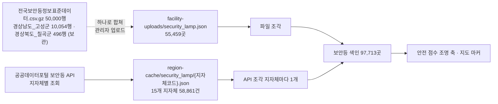

# 보안등 — 데이터 저장

공통 구조(디스크 → 조각 → 색인)는 [DATA_STORAGE.md](../DATA_STORAGE.md) 에 있다. 이 문서는 보안등 만 다룬다.

숫자는 2026-10-11 샘플 삭제 뒤 로컬 서버 기동 로그와 저장소 파일을 세어 확인한 값이다.

## 한 줄 요약

출처가 **둘**이다 — 서버에 둔 보안등 원본 CSV, 그리고 경로가 지나는 지자체마다 받는 공공데이터포털 API. 종류 중 구조가 가장 복잡하다.

## 어디서 오나



| 출처 | 위치 | 건수 | 실데이터인가 |
|---|---|---|---|
| 보안등 원본 CSV 3개 | `backend/data/source/lamp/*.csv.gz` → 하나로 합쳐 업로드 `facility-uploads/security_lamp.json` | 합계 55,459 | 예 |
| 공공데이터포털 API | `backend/data/region-cache/security_lamp/{지자체코드}.json` | 15개 지자체 58,861건, 좌표 기준 49,488곳 | 예 |

지자체 코드는 개방자치단체코드 7자리다(예: 종로구 `3000000`). 지역 캐시 파일 한 항목은 이렇게 생겼다.

```json
{"name":"01-옥인6길15","lat":37.5814361,"lng":126.9645941,"sigunguCode":"3000000",
 "address":"서울특별시 종로구 옥인6길15","phone":"02-2148-3193"}
```

## 언제 바뀌나

경로를 찾으면 경로 위에서 2km 간격으로 최대 12개 좌표를 뽑고, 각 좌표가 속한 지자체를 찾는다. 그 지자체를 90일 안에 받지 않았으면 API 로 받는다.

```kotlin
// SafetySpotFillTrigger.kt:69-83 (발췌)
val code: String? = locator.regionCodeAt(point)   // 좌표 → 지자체 코드
…
securityLampFill.fill(region)                     // 지자체마다 받기
```

받은 결과는 그 지자체 조각만 바꾼다. 결과가 비면 기존 데이터를 지우지 않는다.

```kotlin
// SecurityLampFillService.kt:77-83 (발췌)
// 좌표를 안 주는 지자체가 있다(마포·강남 등) — 빈 캐시로 남겨 매번 다시 받지 않게 한다.
cache.save(SafetySpotType.SECURITY_LAMP, regionCode, points)
…
liveStore.replaceRegion(SafetySpotType.SECURITY_LAMP, regionCode, points)
```

관리자 업로드는 CSV 원본(파일 조각)만 대신하고, API 조각은 남긴다.

보안등 전용 코드는 둘이다 — 시설 모양은 storage `safetyspot/securitylamp/SecurityLampSpot.kt`, CSV 계약은 core `domain/csv/lamp/LampCsvContract.kt`(가로등과 공용, 2026-10-11 업로드로 일원화하면서 원본 3개는 합쳐 올린다 — 업로드는 종류마다 파일 하나).

## 어디에 쓰이나

가로등과 합쳐 안전 점수의 조명 축이 된다(가로등 문서 참고). 지도 마커로도 나간다.

## 이 방식이 맞는가

**맞는 점** — 보안등 API 는 지자체 단위로만 조회된다. 그래서 "필요한 지자체만 받아 파일로 남기고, 그 지자체 조각만 교체"가 API 성격과 맞다. 재시작해도 다시 받지 않는다.

**문제 1 — 전국 CSV 가 정확히 50,000행이다.** 전국 보안등이 이 수에 딱 맞을 가능성은 낮다. 내려받을 때 행 수 상한에 걸려 잘렸을 가능성이 있다. **추정** — 원본 사이트의 전체 건수와 대조하지 않았다.

**문제 2 — 같은 보안등이 두 번 셀 수 있다.** CSV 와 API 가 같은 보안등을 소수점 끝자리가 조금 다른 좌표로 줄 수 있다. 색인은 소수점 5자리(약 1.1m)까지 같아야 하나로 센다. **추정** — 실제 중복률은 재지 않았다.

**문제 3 — 처음 가는 지자체의 첫 요청에는 API 데이터가 없을 수 있다.**

서버는 경로를 찾을 때 API 수집을 **뒤에서(기다리지 않고)** 시작한다. 그래서 처음 가는 지역의 첫 경로 응답에는 그 지역 API 데이터가 아직 없을 수 있다.

```kotlin
// RouteOptionService.kt:38 — 수집을 맡기고 바로 점수 계산으로 넘어간다
routePlannedHandler.onRoutePlanned(firstRoutePath)

// SafetySpotFillTrigger.kt:38 — 실제 수집은 별도 스레드에서 돈다
executor.execute {
```

**문제 4 — 좌표를 주지 않는 지자체는 API 로 채울 수 없다.** 목록은 `docs/lamp-unavailable-districts.md` 에 있다.

**권장**

1. 전국 CSV 의 전체 건수를 원본 사이트와 대조하고, 잘렸으면 나눠 받는다(근본 해결).

2. CSV 와 API 의 같은 지자체 데이터를 비교해 중복률을 잰다. 높으면 API 를 받은 지자체는 CSV 행을 빼는 규칙을 둔다(권장).
