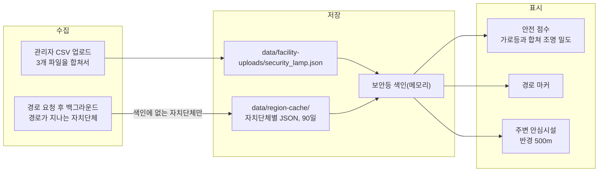

# 보안등: 데이터 수집과 표시

보안등 데이터가 어디서 와서 어떻게 저장되고 어디에 보이는지 정리한다. 여러 시설에 공통인 저장 구조는
[DATA_STORAGE.md](../DATA_STORAGE.md)를 본다.

> 기준: 2026-11-25, 브랜치 `feat/nearby-safety-spot-counts` 
> 건수: `data/source` 원본을 실제 업로드 파서로 읽어 센 값

## 한눈에 보기

| 항목          | 내용                                                       |
|---------------|------------------------------------------------------------|
| 원천          | 전국보안등정보표준데이터, 일부 자치단체 보안등 CSV         |
| 들어오는 길   | 관리자 CSV 업로드 + 경로 요청 시 외부 API로 빈 지역 채우기 |
| 외부 API 수집 | 공공데이터포털 `tn_pubr_public_scrty_lmp_api` (자치단체별) |
| 원본 CSV      | `data/source/lamp/` 3개 파일                               |
| 적재          | 아래 표                                                    |
| 쓰는 곳       | 안전 점수(가로등과 합산), 경로 마커, 주변 안심시설         |

| 원본 CSV                            | 인코딩 |  행 수 |   적재 | 지역 코드 |
|-------------------------------------|--------|-------:|-------:|-----------|
| `전국보안등정보표준데이터.csv.gz`   | CP949  | 50,000 | 44,909 | 있음      |
| `경상남도_고성군_보안등정보.csv.gz` | UTF-8  | 10,054 | 10,054 | 없음      |
| `경상북도_칠곡군_보안등정보.csv.gz` | UTF-8  |    496 |    496 | 없음      |

전국 파일은 좌표가 빈 5,091행을 버린다. 행 수가 정확히 50,000이라 내려받을 때 잘렸을 가능성이 있다.

## CSV 필드

전국 파일에는 13개 필드가 있다. 자치단체 파일 두 개는 앞의 11개만 있고 `제공기관코드`, `제공기관명`이 없다.

| 필드             | 예시                              | 서버가 읽는 용도 |
|------------------|-----------------------------------|------------------|
| 보안등위치명     | 대관령048                         | 이름             |
| 설치개수         | `1`                               | -                |
| 소재지도로명주소 | (빈 칸)                           | -                |
| 소재지지번주소   | 강원도 평창군 대관령면 유천리 804 | 주소             |
| 위도             | `37.65835875`                     | 좌표(위도)       |
| 경도             | `128.5989934`                     | 좌표(경도)       |
| 설치연도         | (빈 칸)                           | -                |
| 설치형태         | (빈 칸)                           | -                |
| 관리기관전화번호 | 033-330-2394                      | -                |
| 관리기관명       | 강원도 평창군청                   | -                |
| 데이터기준일자   | 2022-09-29                        | -                |
| 제공기관코드     | `4281000`                         | 지역 코드        |
| 제공기관명       | 강원특별자치도 평창군             | -                |

외부 API 응답에서는 `latitude`, `longitude`(좌표), `lmpLcNm`(이름), `rdnmadr` 또는 `lnmadr`(주소),
`phoneNumber`(전화), `insttCode`(지역 코드)를 읽는다.

## 흐름

- 경로를 찾으면 경로를 따라 2km마다(최대 12곳) 좌표를 뽑아 자치단체를 찾는다.
- 그 자치단체가 이미 색인에 있거나 90일 캐시에 있으면 API를 부르지 않는다. 실패하면 10분 동안 다시 부르지 않는다.
- 업로드에 이미 있는 자치단체는 API로 받지 않는다. 캐시에 남은 그 지역의 API 조각도 색인에 넣지 않는다.

## 읽는 규칙

업로드 규격은 가로등과 같은 `LampCsvContract`다.

1. 좌표는 `위도`, `경도`를 읽는다. 하나라도 비면 그 행을 버린다.
2. 이름은 `보안등위치명`, 없으면 `관리번호`를 쓴다.
3. 주소는 `설치위치`, 없으면 `소재지지번주소`를 쓴다.
4. 지역 코드는 `개방자치단체코드`, 없으면 `제공기관코드`를 쓴다.

## 갱신 방법

1. 새 판 CSV를 받아 관리자 화면에서 보안등으로 업로드한다. 여러 파일이면 합쳐서 올린다.
2. 받은 파일을 `data/source/lamp/`에 `.gz`로 보관한다.
3. API 지역 조각은 따로 할 일이 없다. 경로 요청이 들어오면 빈 지역을 알아서 채운다.

## 알아둘 점

- 자치단체 파일 두 개처럼 지역 코드 칸이 없는 CSV는 업로드할 때 좌표로 자치단체를 찾아 붙인다(가까운 CCTV의
  `개방자치단체코드`). CCTV가 먼저 올라가 있어야 찾을 수 있다.
- API 키(`DATA_GO_KR_SERVICE_KEY`)가 없으면 API 채우기는 꺼지고 업로드분만 쓴다.
- 업로드 결과와 지역 캐시는 실행 중에 생기는 파일이다. 운영 docker-compose에 볼륨이 없어 컨테이너를 새로 만들면 사라진다.
