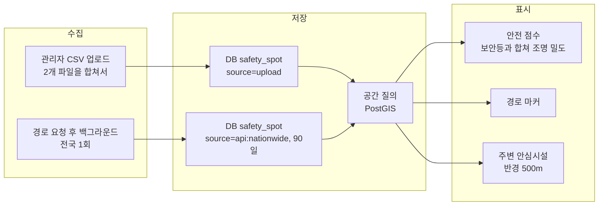

# 가로등: 데이터 수집과 표시

가로등 데이터가 어디서 와서 어떻게 저장되고 어디에 보이는지 정리한다. 여러 시설에 공통인 저장 구조는
[DATA_STORAGE.md](../DATA_STORAGE.md)를 본다.

> 기준: 2026-11-27, 브랜치 `feat/nearby-safety-spot-counts`<br>
> 건수: `data/source` 원본을 풀어 센 값

## 한눈에 보기

| 항목          | 내용                                                        |
|---------------|-------------------------------------------------------------|
| 원천          | 서울 가로등, 스마트 가로등(CSV), 재난안전데이터 가로등(API) |
| 들어오는 길   | 관리자 CSV 업로드 + 경로 요청 시 외부 API 전국 1회          |
| 외부 API 수집 | 재난안전데이터 공유 플랫폼 `DSSP-IF-00084` (전국)           |
| 원본 CSV      | `data/source/street-lamp/` 2개 파일                         |
| 적재          | 아래 표                                                     |
| 쓰는 곳       | 안전 점수(보안등과 합산), 경로 마커, 주변 안심시설          |

| 원본 CSV                            | 인코딩 |  행 수 |   적재 | 지역 코드 |
|-------------------------------------|--------|-------:|-------:|-----------|
| `서울_가로등_위치정보.csv.gz`       | CP949  | 19,316 | 19,291 | 없음      |
| `전국스마트가로등표준데이터.csv.gz` | CP949  | 12,714 | 12,714 | 있음      |

서울 파일은 좌표가 깨진 25행(위도 `0`)을 버린다.

## 필드

서버가 읽는 필드는 들어오는 길마다 다르다.

| 들어오는 길   | 좌표                                 | 이름                           | 주소                             | 지역 코드                              |
|---------------|--------------------------------------|--------------------------------|----------------------------------|----------------------------------------|
| 관리자 업로드 | `위도`, `경도`                       | `보안등위치명` 또는 `관리번호` | `설치위치` 또는 `소재지지번주소` | `개방자치단체코드` 또는 `제공기관코드` |
| 외부 API      | `XMAP_CRTS`, `YMAP_CRTS` (EPSG:5179) | -                              | `ROAD_NM_ADDR`, 없으면 `ADDR`    | `STDG_SGG_CD`                          |

원본 CSV 두 개는 머리글이 다르다. 서울 파일은 `관리번호`, `위도`, `경도` 3칸이고, 스마트 가로등 파일은 27칸 가운데
`위도`, `경도`, `소재지지번주소`, `제공기관코드`를 읽는다.

## 흐름



- 외부 API는 경로 요청이 처음 들어올 때 전국을 한 번 받아 `api:nationwide` 조각으로 넣는다. 그 조각의 저장
  시각(`safety_spot_slice.saved_at`)이 90일 안이면 부르지 않고, 실패하면 10분 동안 다시 부르지 않는다.
- API 조각은 전국 하나라, 업로드가 있어도 지워지지 않고 함께 조회된다(지역 단위로 겹침을 가리지 않는다).

## 읽는 규칙

- 외부 API 좌표는 EPSG:5179 평면좌표라 위경도로 바꾼다. 바꾼 결과가 한국 범위 밖이면 버린다.
- 업로드 규격은 보안등과 같은 `LampCsvContract`다. 좌표가 빈 행은 버린다.

## 갱신 방법

1. 포털에서 새 판 CSV를 받는다. 업로드는 종류마다 파일 하나라서, 머리글이 다른 두 파일을 머리글 이름 기준으로
   합친다.

   ```python
   import csv, gzip, io
   paths = ["서울_가로등_위치정보.csv.gz", "전국스마트가로등표준데이터.csv.gz"]
   tables = [list(csv.DictReader(io.StringIO(gzip.open(path).read().decode("cp949")))) for path in paths]
   header = list(dict.fromkeys(name for table in tables for name in table[0]))
   with open("가로등_통합.csv", "w", newline="", encoding="utf-8") as f:
       writer = csv.DictWriter(f, fieldnames=header, restval="")
       writer.writeheader()
       for table in tables:
           writer.writerows(table)
   ```

2. 합친 파일을 관리자 화면에서 가로등으로 업로드한다.
3. 받은 원본을 `data/source/street-lamp/`에 `.gz`로 보관한다.
4. 외부 API 조각은 따로 할 일이 없다. 90일이 지나면 다음 경로 요청 때 다시 받는다.

2026-11-27 저장소의 원본 두 개를 이 방법으로 합쳐 32,030행(좌표가 유효한 행 32,005)을 확인했다. 합친 파일의 실제
업로드는 실행하지 않았다.

## 알아둘 점

- 새 DB에는 가로등이 없다. 업로드하기 전까지는 외부 API 조각만 쓴다. 키(`SAFETYDATA_SERVICE_KEY`)도 없으면 0건이다.
- 2026-11-27까지는 서버가 켜질 때 `cdn/lamp/`의 JSON(위 두 CSV와 같은 데이터)을 DB의 `cdn` 조각으로 옮겼다. 그
  파일은 지웠다. 이미 운영 중인 DB에 들어 있는 `cdn` 조각(32,005건)은 지워지지 않고, 가로등을 업로드하면 업로드분이
  대신한다.
- 업로드분과 API 조각은 DB(운영 compose의 `db-data` 볼륨)에 남아 배포하거나 재시작해도 유지된다.
