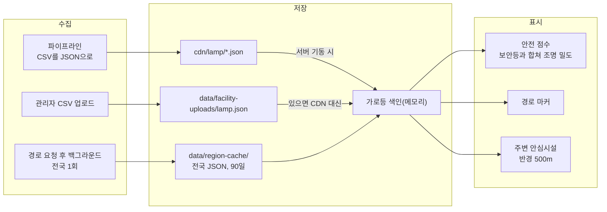

# 가로등: 데이터 수집과 표시

가로등 데이터가 어디서 와서 어떻게 저장되고 어디에 보이는지 정리한다. 여러 시설에 공통인 저장 구조는
[DATA_STORAGE.md](../DATA_STORAGE.md)를 본다.

> 기준: 2026-11-25, 브랜치 `feat/nearby-safety-spot-counts` 
> 건수: 저장소의 CDN 파일을 세어 확인한 값

## 한눈에 보기

| 항목          | 내용                                                           |
|---------------|----------------------------------------------------------------|
| 원천          | 서울 가로등, 스마트 가로등(파이프라인), 재난안전데이터 가로등  |
| 들어오는 길   | CDN 파일 + 경로 요청 시 외부 API 전국 1회 + 관리자 CSV 업로드  |
| 외부 API 수집 | 재난안전데이터 공유 플랫폼 `DSSP-IF-00084` (전국)              |
| 원본 CSV      | 저장소에 없음(파이프라인 입력은 `pipeline/data/csv/`)          |
| 적재          | `cdn/lamp/seoul.json` 19,291건, `cdn/lamp/smart.json` 12,714건 |
| 쓰는 곳       | 안전 점수(보안등과 합산), 경로 마커, 주변 안심시설             |

## 필드

가로등은 원본 CSV가 저장소에 없다. 서버가 읽는 필드는 들어오는 길마다 다르다.

| 들어오는 길   | 좌표                                 | 이름                           | 주소                             | 지역 코드                              |
|---------------|--------------------------------------|--------------------------------|----------------------------------|----------------------------------------|
| CDN 파일      | `lat`, `lng`                         | `name`                         | -                                | -                                      |
| 외부 API      | `XMAP_CRTS`, `YMAP_CRTS` (EPSG:5179) | -                              | `ROAD_NM_ADDR`, 없으면 `ADDR`    | `STDG_SGG_CD`                          |
| 관리자 업로드 | `위도`, `경도`                       | `보안등위치명` 또는 `관리번호` | `설치위치` 또는 `소재지지번주소` | `개방자치단체코드` 또는 `제공기관코드` |

CDN 파일은 파이프라인(`pipeline/`)이 원본 CSV를 위경도 JSON으로 바꿔 만든다. 원본 컬럼은
[pipeline/data/csv/README.md](../../pipeline/data/csv/README.md)에 있다.

## 흐름

- 서버는 켜질 때 CDN 파일을 읽고, 업로드가 있으면 그것으로 CDN 파일을 대신한다.
- 외부 API는 경로 요청이 처음 들어올 때 전국을 한 번 받는다. 90일 캐시가 있으면 부르지 않고, 실패하면 10분 동안 다시
  부르지 않는다.
- API 조각은 전국 하나라, 업로드가 있어도 함께 색인에 붙는다(지역 단위로 겹침을 가리지 않는다).

## 읽는 규칙

- 외부 API 좌표는 EPSG:5179 평면좌표라 위경도로 바꾼다. 바꾼 결과가 한국 범위 밖이면 버린다.
- 업로드 규격은 보안등과 같은 `LampCsvContract`다. 좌표가 빈 행은 버린다.

## 갱신 방법

1. CDN 파일은 파이프라인 월간 실행으로 바뀐다. 절차는 [pipeline/README.md](../../pipeline/README.md)를 본다.
2. 외부 API 조각은 90일이 지나면 다음 경로 요청 때 다시 받는다.

## 알아둘 점

- 키(`SAFETYDATA_SERVICE_KEY`)가 없으면 외부 API 채우기는 꺼지고 CDN 파일만 쓴다.
- 지역 캐시는 실행 중에 생기는 파일이다. 운영 docker-compose에 볼륨이 없어 배포할 때마다 전국을 다시 받는다.
