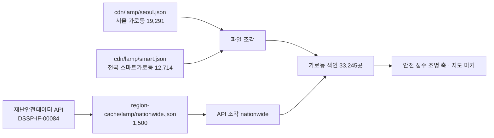

# 가로등 — 데이터 저장

공통 구조(디스크 → 조각 → 색인)는 [DATA_STORAGE.md](../DATA_STORAGE.md) 에 있다. 이 문서는 가로등 만 다룬다.

숫자는 2026-10-11 샘플 삭제 뒤 로컬 서버 기동 로그와 저장소 파일을 세어 확인한 값이다.

## 한 줄 요약

파이프라인이 넣은 **서울·스마트가로등 파일 두 개**에, 재난안전데이터 **API 로 받은 전국 1,500곳**을 더한다. 와이어 이름은 `lamp` 다.

## 어디서 오나



| 출처 | 위치 | 건수 | 실데이터인가 |
|---|---|---|---|
| 서울 가로등 (C-1) | `cdn/lamp/seoul.json` | 19,291 | 예 (커밋 fd53e6a8) |
| 전국 스마트가로등 (C-4) | `cdn/lamp/smart.json` | 12,714 | 예 (커밋 cc3e7199) |
| 재난안전데이터 API | `backend/data/region-cache/lamp/nationwide.json` | 1,500 | 예 |

API 는 지역을 나누지 않고 전국을 한 번에 준다. 클라이언트가 마지막 페이지까지 넘겨 받으므로, 1,500 은 API 가 가진 전체다.

```kotlin
// StreetLampClient.kt:37 — totalCount 에 닿을 때까지 페이지를 넘긴다(한 페이지 1,000건, 최대 50쪽)
for (pageNo in 1..MAX_PAGES) {
```

## 언제 바뀌나

경로를 찾을 때마다 수집을 시도하지만, 받은 지 90일이 안 됐으면 건너뛴다. 90일이 지나면 다시 받아 `nationwide` 조각을 새 결과로 바꾼다.

```kotlin
// StreetLampFillService.kt:64-69 (발췌)
cache.save(SafetySpotType.STREET_LAMP, NATIONWIDE, points)
…
liveStore.replaceRegion(SafetySpotType.STREET_LAMP, NATIONWIDE, points)
```

서울·스마트가로등 파일은 실행 중에 바뀌지 않는다. 새로 받으려면 파이프라인을 다시 돌려 파일을 교체해야 한다.

## 어디에 쓰이나

가로등과 보안등을 **합쳐서** 안전 점수의 조명 축을 만든다. 지도 마커로도 나간다.

```kotlin
// SafetyScorer.kt:108-110
lamp =
    countWithinCorridor(SafetySpotType.STREET_LAMP, path) +
        countWithinCorridor(SafetySpotType.SECURITY_LAMP, path),
```

## 이 방식이 맞는가

**맞는 점** — API 가 전국 1,500건을 한 번에 주므로 지역을 나눌 필요가 없다. `nationwide` 조각 하나를 90일마다 바꾸는 지금 방식이 맞다.

**문제 1 — 서울·스마트가로등 파일을 새로 고칠 길이 서버에 없다.** 파이프라인을 사람이 다시 돌려야 해서, 오래 두면 데이터가 낡는다.

**문제 2 — 첫 요청에는 API 데이터가 없을 수 있다.** 다만 전국 한 번 받기라 서버가 켜진 뒤 첫 경로 한 번에만 해당한다.

서버는 경로를 찾을 때 API 수집을 **뒤에서(기다리지 않고)** 시작한다. 그래서 처음 가는 지역의 첫 경로 응답에는 그 지역 API 데이터가 아직 없을 수 있다.

```kotlin
// SafeRouteService.kt:38 — 수집을 맡기고 바로 점수 계산으로 넘어간다
routePlannedHandler.onRoutePlanned(firstRoutePath)

// SafetySpotFillTrigger.kt:38 — 실제 수집은 별도 스레드에서 돈다
executor.execute {
```

**권장** — 서울·스마트가로등도 관리자 업로드로 갱신할 수 있게 절차를 문서화한다(권장). 지금 구조를 바꿀 필요는 없다.
